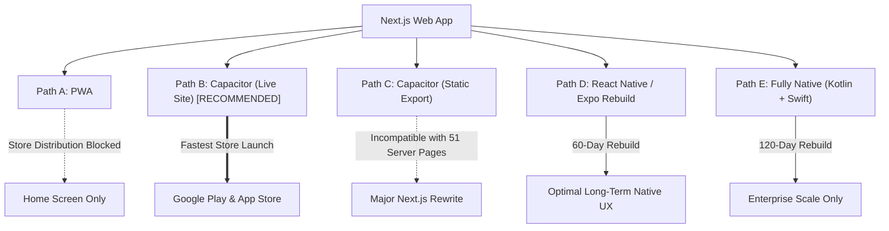

# MOBILE READINESS & ARCHITECTURE AUDIT: TRILLION SKILLS (ASPIRANTBOOK)

**Date**: October 21, 2026  
**Auditor**: Senior Systems & Mobile Architect  
**Codebase**: Trillion Skills / aspirantbook (Next.js 15.1.4 App Router, React 19, TypeScript, Tailwind CSS, Prisma 6.2, Supabase PostgreSQL)  
**Target Goal**: Turn this web app into Android (and later iOS) apps with minimum rewrite, maximum code reuse, and zero store rejection risk.

---

## 1. Stack and Versions

### Core Technologies
- **Next.js**: `15.1.4` (App Router only; no `pages/` directory exists).
- **React / React DOM**: `^19.0.0` (React 19 release with Server Components & Server Actions).
- **Node.js**: `v23.6.1` (local environment runtime; Node >= 18 supported).
- **TypeScript**: `5.9.3` (`tsconfig.json` with strict type checking, path alias `@/*`).
- **Prisma ORM**: `^6.2.0` (`prisma/schema.prisma`).
- **Database**: PostgreSQL hosted on Supabase (`DATABASE_URL` via PgBouncer port 6543, `DIRECT_URL` port 5432).
- **NextAuth / Auth.js**: `^5.0.0-beta.25` (`next-auth` beta release with JWT strategy).
- **Tailwind CSS**: `^4.0.0` with `@tailwindcss/postcss` and `@tailwindcss/animate`.
- **UI Components & Icons**: Radix UI primitives (`@radix-ui/react-*`), `lucide-react` (`^0.468.0`), `sonner` (`^2.0.7`), Framer Motion (`^12.23.24`).
- **State & Data Libraries**: `@tanstack/react-query` (`^5.62.11`), `@trpc/server` / `@trpc/client` (`^11.0.0-rc.690`), `superjson`, `date-fns`, React Hook Form (`^7.66.1`), Zod (`^3.25.76`).
- **Package Manager & Repo Structure**: Single repository (`npm`, lockfile `package-lock.json`), no monorepo tooling (Turborepo/Lerna/Nx not used).
- **Scripts**:
  - `dev`: `NODE_OPTIONS='--max-old-space-size=4096' next dev`
  - `build`: `next build`
  - `start`: `next start`
  - `lint`: `next lint`
  - `postinstall`: `prisma generate`

### `next.config.js` Inspection
- **Output Mode**: Standard default (Node.js server-rendered). No `output: 'export'` (static HTML export) or `output: 'standalone'`.
- **Images Configuration**: Formats `avif`, `webp`; `dangerouslyAllowSVG: true`; remote patterns allow all HTTPS hosts (`https://**`).
- **Headers & CSP**:
  - `X-Frame-Options: SAMEORIGIN`
  - `Permissions-Policy: camera=(), microphone=(), geolocation=(), browsing-topics=()`
  - `Content-Security-Policy`:
    `default-src 'self'; script-src 'self' 'unsafe-inline' 'unsafe-eval' https://checkout.razorpay.com https://api.razorpay.com https://www.youtube.com https://s.ytimg.com; style-src 'self' 'unsafe-inline' https://fonts.googleapis.com; font-src 'self' data: https://fonts.gstatic.com; img-src 'self' data: blob: https://*.razorpay.com https: http:; frame-src 'self' https://api.razorpay.com https://checkout.razorpay.com https://www.youtube.com https://www.youtube-nocookie.com blob: data:; connect-src 'self' https://api.razorpay.com https://lumberjack.razorpay.com https://*.amazonaws.com https://*.supabase.co wss:; media-src 'self' https: blob:; worker-src 'self' blob:; object-src 'none'; base-uri 'self'; form-action 'self' https://api.razorpay.com; frame-ancestors 'self';`
- **Experimental Flags**:
  - `staleTimes: { dynamic: 30, static: 180 }`
  - `optimizePackageImports`: 21 packages optimized.
- **Rewrites & Redirects**: None in `next.config.js`. Path routing handled via `middleware.ts`.

---

## 2. How Data and Actions Reach the Client

### 2.1 API Routes (`app/api`)
There are **120 API route files** under `app/api`. Below is the categorized breakdown:

| Category | Route Count | Typical Methods | Auth Requirement | Response Type | Mobile-Callable Today? |
| :--- | :--- | :--- | :--- | :--- | :--- |
| **Auth & User** (`/api/auth/*`, `/api/user/*`) | 6 | `POST, GET` | Session / Dev Bypass | JSON | **Partial** (`mobile-login` is disabled in prod; `/api/auth/[...nextauth]` expects cookie) |
| **Exam & Test Series** (`/api/exam/*`) | 38 | `GET, POST, PATCH, DELETE` | Session / Admin | JSON | **Yes** (JSON endpoints for start, questions, sync, finish) |
| **Books & Orders** (`/api/books/*`, `/api/admin/books/*`) | 12 | `GET, POST, PUT, DELETE` | Mixed (Public / Session) | JSON / Stream | **Yes** (Catalog, cart, create-order, verify) |
| **PYQs** (`/api/pyqs/*`, `/api/admin/pyqs/*`) | 10 | `GET, POST, PUT, DELETE` | Session / Admin / Public | JSON / Redirect | **Yes** (Paper lists, lead forms, file redirect) |
| **Courses & Classes** (`/api/admin/courses/*`, `/api/teacher/classes/*`) | 18 | `GET, POST, PUT, DELETE` | Admin / Teacher | JSON | **Yes** (Staff management) |
| **Tutorials** (`/api/admin/tutorials/*`, `/api/tutorials/*`) | 12 | `GET, POST, PUT, DELETE` | Admin / Teacher | JSON | **Yes** (Editor & versioning APIs) |
| **Current Affairs** (`/api/admin/current-affairs/*`, `/api/current-affairs/*`) | 6 | `GET, POST, PUT, DELETE` | Admin / Public | JSON / Stream | **Yes** (PDF listings & download) |
| **Payments & Webhooks** (`/api/verify-payment/*`, `/api/webhooks/*`) | 6 | `POST` | Signature / Session | JSON | **Yes** (Razorpay & Stripe verification) |
| **Uploads & Media** (`/api/upload/*`) | 4 | `POST, DELETE` | Session | JSON | **Yes** (S3 presigned URLs) |
| **System & Health** (`/api/health`, `/api/execute`, `/api/goals`) | 8 | `GET, POST` | Mixed | JSON | **Yes** |

### 2.2 Server Actions (`"use server"`)
There are **24 server action files** exporting **117 distinct server actions**.
- **Admin & Authoring Actions** (`lib/actions/admin/*`):
  - `courses.ts` (13 actions), `users.ts` (15 actions), `lessons.ts` (10 actions), `course-metadata.ts` (9 actions), `assessments.ts` (8 actions), `tracks.ts` (8 actions), `chapters.ts` (6 actions), `settings.ts` (5 actions), `analytics.ts` (4 actions), `exercises.ts` (3 actions), `profile.ts` (3 actions), `publishing.ts` (2 actions), `audit.ts` (2 actions), `tutorial-import.ts` (1 action).
- **Learner & Portal Actions**:
  - `lib/actions/auth.ts` (7 actions: `register`, `authenticate`, `verifyEmailAction`, `resendVerificationEmailAction`, `requestPasswordReset`, `resetPasswordWithToken`, `signOutAction`). Called by `LoginForm.tsx`, `RegisterForm.tsx`, `ResetPasswordForm.tsx`.
  - `lib/actions/user/profile.ts` (6 actions: `updateProfile`, `updateAvatar`, `changePassword`, `updateNotificationPreferences`, `updatePrivacySettings`, `deleteAccount`). Called by `SettingsClient.tsx`, `ProfileClient.tsx`.
  - `lib/actions/course/progress.ts` (5 actions: `markLessonComplete`, `toggleLessonCompletion`, `trackVideoProgress`, `getNextLesson`). Called by `LessonViewer.tsx`, `CoursePlayerClient.tsx`.
  - `lib/actions/course/enrollment.ts` (3 actions: `enrollInCourse`, `checkEnrollmentStatus`, `unenrollFromCourse`). Called by `CourseCard.tsx`, `BatchDetailClient.tsx`.
  - `lib/actions/gamification.ts` (2 actions: `awardXP`, `syncLeaderboard`).
  - `lib/actions/payment/razorpay.ts` (1 action: `createRazorpayOrder`). Called by `useSamePageBuyNow.ts`, `CheckoutClient.tsx`.
  - `lib/actions/payment/stripe.ts` (1 action: `createCheckoutSession`).
  - `lib/actions/tracks/career.ts` (2 actions: `getCareerTracks`, `getCareerTrackBySlug`).
  - `lib/actions/user/subscription.ts` (1 action: `upgradeSubscription`).

*Note on Server Actions in Native Mobile Apps*: Server actions use Next.js internal POST requests (`Next-Action` header with compiled action ID). They are not standard REST APIs. In React Native or standard mobile clients, invoking server actions directly is brittle and unsupported; standard REST/JSON endpoints must be exposed instead. In a Capacitor WebView, server actions work seamlessly because the browser runtime handles `Next-Action` serialization.

### 2.3 Module Architecture & Mobile Callability Matrix

| Module | Primary Web Mechanism | Mobile-Callable Today? | What Must Be Added for Native / Mobile API |
| :--- | :--- | :--- | :--- |
| **Tutorials** | Server Component (`/tutorials`, `/tutorials/[slug]`) with direct Prisma queries + Server Actions | **NO** (Client view is SSR only) | Add `GET /api/tutorials` and `GET /api/tutorials/[slug]` returning sanitized DTOs. |
| **Test Series & Attempts** | REST API (`/api/exam/*`) + Client View (`AttemptClient.tsx`) | **YES** | Add Bearer Token auth support; API contracts are already clean JSON. |
| **PYQs** | Mixed: Server Component listing (`/pyqs`) + REST (`/api/pyqs/[paperId]`) | **PARTIAL** | Add `GET /api/pyqs` catalog endpoint with goal filtering. |
| **Current Affairs & Quizzes** | Server Component listing + REST (`/api/current-affairs/*`) | **PARTIAL** | Add `GET /api/current-affairs` listing endpoint. |
| **Books & Orders** | Client Component (`/books`) + REST (`/api/books/*`) | **YES** | Already talks via JSON API (`/api/books`, `/api/books/checkout/*`). |
| **Courses & Batches** | Server Component (`/courses`, `/courses/[slug]`) | **NO** | Add `GET /api/courses` and `GET /api/courses/[slug]` DTO endpoints. |
| **Pricing & Subscriptions** | Server Actions (`createRazorpayOrder`, `createCheckoutSession`) | **PARTIAL** | Wrap `createRazorpayOrder` in a standard `POST /api/payment/create-order` endpoint. |
| **Profile & Settings** | Server Component + Server Actions (`profile.ts`) | **PARTIAL** | Add `GET /api/user/profile` and `PATCH /api/user/profile`. |
| **Admin & Teacher Studios** | Heavy Web Client (`UniversalEditor`, `MonacoEditor`, `VideoCourseEditorClient`) | **NO (Web only)** | Keep on Web/Desktop; teachers author via web browser. |

### 2.4 Server Components Fetching Data Directly with Prisma (51 Pages)
These pages execute direct Prisma database queries in `page.tsx` and cannot be invoked from an external native mobile client:
1. `app/(dashboard)/courses/page.tsx` & `app/(dashboard)/courses/[slug]/page.tsx`
2. `app/(dashboard)/tutorials/page.tsx` & `app/(dashboard)/tutorials/[slug]/page.tsx`
3. `app/(dashboard)/pyqs/page.tsx` & `app/(dashboard)/pyqs/[examId]/page.tsx`
4. `app/(dashboard)/current-affairs-quizzes/page.tsx`
5. `app/(dashboard)/dashboard/page.tsx` & `app/(dashboard)/my-learning/page.tsx`
6. `app/(dashboard)/my-tests/page.tsx` & `app/(dashboard)/test-series/[id]/page.tsx`
7. `app/(dashboard)/tracks/page.tsx` & `app/(dashboard)/tracks/[slug]/page.tsx`
8. `app/(dashboard)/profile/page.tsx` & `app/(dashboard)/settings/page.tsx`
9. `app/(dashboard)/assessments/[id]/page.tsx` & `app/(dashboard)/assessments/[id]/take/page.tsx`
10. `app/(exam)/test-series/[id]/attempt/page.tsx` & `app/(exam)/test-series/[id]/solutions/page.tsx`

---

## 3. Auth and Sessions

### 3.1 Authentication Mechanisms
- **Credentials Provider** (`auth.ts`): Email + password validated via `bcrypt.compare`. Protected by DB-backed lockout (`checkLoginLockout`, max 5 failed attempts, 15-minute lock).
- **Mobile OTP Provider**:
  - `auth.ts` defines a `mobile` Credentials provider, but it is **strictly gated** to local development/test DB (`isDevBypassEnabled`). In production, it returns `null` or `503`.
  - `app/api/auth/mobile-login/route.ts` creates/finds users with synthetic emails (`mobile_<phone>@aspirantbook.local`), but SMS integration (Fast2SMS/MSG91/Twilio) is **not connected**.
- **Google OAuth**:
  - `LoginForm.tsx` (L128) and `RegisterForm.tsx` (L70) have Google login buttons, but clicking them executes:
    `alert("Google OAuth login initialized. Set GOOGLE_CLIENT_ID & GOOGLE_CLIENT_SECRET in .env.local to activate production redirect.")`
  - There is **no Google provider configured** in `auth.ts` or `auth.config.ts`.
- **Session Strategy**:
  - **JWT-based** (`session: { strategy: "jwt", maxAge: 30 * 24 * 60 * 60 }` — 30 days).
  - Cookies:
    - Production: `__Secure-authjs.session-token` (`httpOnly: true`, `sameSite: "lax"`, `secure: true`, `path: "/"`).
    - Development: `authjs.session-token` (`httpOnly: true`, `sameSite: "lax"`, `secure: false`, `path: "/"`).
  - Periodic session revocation: Every 10 seconds (or on `trigger === "update"`), the JWT callback queries Prisma to verify `dbUser.sessionVersion === token.sessionVersion` and `dbUser.isActive !== false`. Mismatch invalidates the session globally across all devices.
  - CSRF: Built into Auth.js via CSRF tokens for web form submissions.

### 3.2 Non-Browser & Mobile App Capability
- **Token-based Auth (Bearer/JWT)**: **DOES NOT EXIST**.
  - Neither Auth.js nor custom route handlers read `Authorization: Bearer <token>`.
  - Every auth check inspects `req.auth` or calls `auth()`, which relies exclusively on reading HTTP cookies via Next.js headers (`cookies().get(...)`).
- **Android WebView Compatibility**:
  - **Cookies**: Standard WebViews support cookies if `CookieManager.getInstance().setAcceptCookie(true)` is enabled.
  - **Third-Party Cookies**: If using Capacitor on `https://localhost` or `capacitor://localhost` communicating with `https://api.aspirantbook.com`, cookies with `SameSite=Lax` or `SameSite=Strict` will be treated as third-party cross-site cookies and **silently blocked by Android WebView / iOS WKWebView**.
  - **Google OAuth in WebView**: Google blocks OAuth requests initiated inside embedded WebViews (`disallowed_useragent` error). Google Sign-In on mobile **must** use a native OAuth bridge (`@codetrix-studio/capacitor-google-auth` or native SDK) that exchanges an ID token with the server.
  - **Authwall Unlock / Scroll Restore**:
    - Handled via `lib/authwall/resolveAccess.ts` on the server and `components/editor/AspirantbookTutorialView.tsx` on the client.
    - Slicing is done server-side before sending HTML/blocks to the client.
    - Client unlocking does not rely on browser-only APIs; it conditionally renders gates based on `hasAccess` or user entitlements.

---

## 4. Payments

### 4.1 Razorpay Architecture
- **Order Creation**: `lib/actions/payment/razorpay.ts` (`createRazorpayOrder`) creates a server-authoritative order via `razorpay.orders.create({ amount, currency: "INR", notes })`.
- **Client Checkout Launch**: `lib/payments/useRazorpayCheckout.ts` dynamically injects `https://checkout.razorpay.com/v1/checkout.js` and instantiates `new window.Razorpay(options).open()`.
- **Payment Verification**:
  - User completes payment in Razorpay modal.
  - Client sends signature to `POST /api/verify-payment/razorpay` (`orderId`, `paymentId`, `signature`).
  - Server verifies HMAC SHA-256 signature using `RAZORPAY_KEY_SECRET`.
  - Idempotent fulfillment executed via `lib/payments/fulfilment.ts`.
- **Webhook Fallback**: `POST /api/webhooks/razorpay` verifies header `x-razorpay-signature` and calls `lib/payments/fulfilment.ts` (`payment.captured` event).

### 4.2 Purchasable Items & Google Play / Apple IAP Compliance
Every item sold on Trillion Skills is **purely digital**:
1. **Course Batches** (`courseId`): Video lessons, study materials.
2. **Platform Subscriptions** (`plan: "MONTHLY" | "YEARLY"`): Unlocks all courses/tests.
3. **Digital eBooks** (`bookId`): High-resolution PDF downloads and reader access.
4. **Test Series Packages**: CBT mocks and question banks.
5. **Physical Goods**: **NONE**. Zero physical shipping exists.

> [!WARNING]
> **Store Compliance Blocker (Google Play & Apple App Store)**:
> Under Google Play Billing Policy and Apple App Store Review Guideline 3.1.1, **any digital content consumed inside the mobile app (courses, test series, eBook PDFs, digital subscriptions) MUST be purchased through Google Play Billing (Android) and Apple In-App Purchase (iOS)**.
> Using Razorpay or web credit card forms inside an app submitted to Google Play or Apple App Store will lead to **immediate app rejection or removal**.
> *Workarounds*:
> - Integrate Google Play Billing / Apple IAP natively or via RevenueCat.
> - Or adopt a "Reader App" model (allow users to read/access content purchased on the web, but disable purchase buttons inside the iOS/Android app).

---

## 5. Files, PDFs and Media

### 5.1 Storage & Delivery
- **Cloud Storage**: AWS S3 (`@aws-sdk/client-s3`). Bucket configured via `AWS_S3_BUCKET_NAME`.
- **Upload Flow**: Client calls `POST /api/upload/presigned-url` to obtain a signed S3 upload URL, uploading directly to S3 without passing bytes through the Next.js server.
- **Serving Files**:
  - Public images/assets: Served directly from S3 bucket or `/public`.
  - Protected PDFs: Served via streaming route handlers:
    - `/api/books/[id]/download`: Authenticates user, checks order completion, streams PDF from S3.
    - `/api/pyqs/file/[paperId]`: Verifies entitlement/role, redirects to S3 signed URL or streams.
    - `/api/current-affairs/file/[id]`: Streams monthly CA magazines.

### 5.2 `SecurePdfViewer` Implementation
- Located at [components/pdf/SecurePdfViewer.tsx](file:///Users/praveenkumar/TrillionSkill/components/pdf/SecurePdfViewer.tsx).
- **Renderer**: Uses an HTML `<iframe>` pointing to the streaming endpoint (`src={resolvedSrc}`).
- **Mobile Compatibility Issue**:
  - **iOS Safari / WKWebView**: Renders PDF natively inside `<iframe>`.
  - **Android WebView**: **DOES NOT render PDFs inside iframes**. In standard Android WebViews, pointing an iframe to a PDF content-type prompts a file download or shows a blank gray box.
  - *Fix*: Must use `pdfjs-dist` (already installed in `package.json`) to render PDF pages onto HTML5 `<canvas>` elements, or use a native Capacitor/React Native PDF viewer plugin (`react-native-pdf` / `@capacitor-community/file-opener`).

### 5.3 Anti-Copy & Offline Requirements
- **Current Anti-Copy**: Disables body scroll, context menu, and hides raw storage URLs behind API streaming proxies.
- **Offline Student Needs**:
  - Students in rural areas frequently request offline access to:
    1. Downloaded eBook PDFs (stored securely in app sandbox).
    2. Test series attempt packages (taking full mock tests without active internet).
    3. Saved bookmarks and flashcards.

---

## 6. UI and Mobile-Readiness

### 6.1 Responsive Status at 360px
- All core dashboard, tutorials, pyqs, test series, and book store pages were built and verified against mobile standards (360px viewport baseline, 44px touch targets).
- Bottom navigation shell exists: `NEXT_PUBLIC_ENABLE_MOBILE_NATIVE_SHELL` toggles a mobile drawer and bottom navigation tabs below `1024px` (`lg`).
- Viewport CSS: Layouts use `dvh` (dynamic viewport height) and safe area padding (`pb-24 lg:pb-8`).

### 6.2 Browser-Only APIs in Use
The codebase uses several browser-only APIs that require guards (`typeof window !== "undefined"`):
1. `localStorage`: Used in theme toggle (`ts_theme`), books cart (`ts_book_cart`), pending checkout intent (`ts_pending_book_checkout`), and test filters.
2. `sessionStorage`: Used in auth return path caching and quiz state.
3. `IndexedDB`: Used in exam autosave via custom IDB helper (`saveExamState`, `getExamState`).
4. `document.fullscreenElement` & `requestFullscreen()`: Used in exam attempts.
5. `window.history.pushState` & `popstate`: Used in exam back-button trapping.
6. `window.addEventListener("online" | "offline" | "beforeunload" | "pagehide")`: Used in exam attempt syncing.
7. `Web Worker`: Exam timer uses `new Worker('/workers/exam-timer.worker.js')`. In Capacitor or WebView, web workers work, but paths must be relative or bundled.

### 6.3 PWA Assets Audit
- **Manifest**: [public/manifest.json](file:///Users/praveenkumar/TrillionSkill/public/manifest.json) exists. Linked in `app/layout.tsx`.
- **Icons**:
  - `public/icons/icon-192.png`: **BROKEN / PLACEHOLDER (70 bytes)**.
  - `public/icons/icon-512.png`: **BROKEN / PLACEHOLDER (70 bytes)**.
  - *Missing*: Maskable icons, 48x48, 72x72, 96x96, 144x144, Apple touch icons (`apple-touch-icon.png`).
- **Service Worker**: **MISSING**. No service worker exists in `public/` or is registered in `app/`.
- **Theme Color**: Present in `app/layout.tsx` (`#ffffff` light, `#05192D` dark).
- **Apple Mobile Web App Tags**: Present in `app/layout.tsx` (`capable: true`, `statusBarStyle: 'default'`).

---

## 7. Exam and Quiz Specifics

### 7.1 Anti-Cheat & Attempt Handling ([AttemptClient.tsx](file:///Users/praveenkumar/TrillionSkill/app/(exam)/test-series/[id]/attempt/AttemptClient.tsx))
- **Timer Engine**: Uses a Web Worker (`/workers/exam-timer.worker.js`) with server-synchronized start timestamp (`attemptData.startedAt` + `durationMinutes`). Survives tab switching and background throttling.
- **Tab-Switch & Visibility Detection**:
  - Listens to `document.addEventListener("visibilitychange", ...)`.
  - When document becomes `hidden`, flushes dirty answers immediately to `/api/exam/attempt/[id]/sync` and increments `tabSwitchCount`.
  - When `tabSwitchCount` exceeds threshold, warns user and logs audit record.
  - *WebView / App Behavior*: In a native app or WebView, pressing the home button or receiving a phone call triggers `visibilitychange` (`hidden`). The app must not instantly disqualify students on phone calls without native app lifecycle handling.
- **Back-Button Trapping**:
  - Injects `window.history.pushState(null, "", window.location.href)` and listens to `popstate`.
  - Intercepts back navigation and opens confirmation modal ("Leave exam?").
  - *Android Back Button*: In an Android WebView or Capacitor app, the **hardware back button** bypasses browser history unless intercepted via `@capacitor/app` (`App.addListener('backButton')`).
- **Fullscreen Enforcement**:
  - Requests `document.documentElement.requestFullscreen()`.
  - Listens to `fullscreenchange`. If user exits fullscreen, displays persistent modal banner to resume fullscreen.
  - *App Behavior*: A native Android/iOS app is fullscreen by default; browser fullscreen APIs are redundant or no-ops in native webviews.
- **Autosave & Poor Network Recovery**:
  - Triple-redundant autosave:
    1. Debounced IndexedDB write (`saveExamState`, 2000ms).
    2. Server sync (`/api/exam/attempt/[id]/sync`, 2500ms) with sequence numbering (`syncSeqRef`).
    3. `online` event listener automatically replays pending submission when network reconnects.

---

## 8. Notifications and Engagement

### 8.1 Existing Infrastructure
- **Database Model**: `Notification` model exists in `prisma/schema.prisma` with fields: `id`, `userId`, `type` (`COURSE_UPDATE`, `NEW_CONTENT`, `ACHIEVEMENT`, `LEADERBOARD`, `SUBSCRIPTION`, `SYSTEM`), `title`, `message`, `link`, `read`, `createdAt`.
- **In-App Notifications**: Created on gamification/achievement unlock (`lib/actions/gamification.ts`) and course updates.
- **Email Notifications**: Resend integration in `lib/email.ts` sends verification emails and password reset links.

### 8.2 What Is Missing for Mobile Push
- **Push Token Storage**: **MISSING**. No table exists to store device tokens (FCM tokens, APNs tokens, or Web Push endpoints).
- **Web Push (VAPID)**: No service worker or VAPID key configuration exists.
- **Requirements for Firebase Cloud Messaging (FCM)**:
  1. Add `DevicePushToken` model to `schema.prisma` (`userId`, `token`, `platform: ANDROID | IOS | WEB`, `createdAt`, `updatedAt`).
  2. Add `POST /api/user/push-token` endpoint for mobile app registration.
  3. Install `firebase-admin` on the Next.js server to dispatch push notifications for daily quiz reminders, exam schedule alerts, and streak reminders.

---

## 9. Environment, Hosting and Config for Mobile

### 9.1 Environment Variables (43 Configured)
- **App & URLs**: `NEXT_PUBLIC_APP_URL`, `NEXT_PUBLIC_SITE_URL`, `NEXTAUTH_URL`, `NODE_ENV`, `APP_ENV`.
- **Database & Cache**: `DATABASE_URL`, `DIRECT_URL`, `DEV_DATABASE_URL`, `DEV_DIRECT_URL`, `TEST_DATABASE_URL`, `REDIS_URL`.
- **Authentication**: `FAST2SMS_API_KEY`, `MSG91_AUTH_KEY`, `TWILIO_AUTH_TOKEN`, `ALLOW_DEV_MOBILE_LOGIN`, `REQUIRE_EMAIL_VERIFICATION_FOR_PURCHASE`.
- **Payments**: `RAZORPAY_KEY_ID`, `RAZORPAY_KEY_SECRET`, `NEXT_PUBLIC_RAZORPAY_KEY_ID`, `RAZORPAY_WEBHOOK_SECRET`, `STRIPE_SECRET_KEY`, `STRIPE_WEBHOOK_SECRET`, `STRIPE_MONTHLY_PRICE_ID`, `STRIPE_YEARLY_PRICE_ID`.
- **Storage & Media**: `AWS_ACCESS_KEY_ID`, `AWS_SECRET_ACCESS_KEY`, `AWS_REGION`, `AWS_S3_BUCKET_NAME`, `AWS_S3_BUCKET`, `AWS_CLOUDFRONT_DOMAIN`, `BOOK_PDF_WATERMARK`.
- **Agora Live Video**: `NEXT_PUBLIC_AGORA_APP_ID`, `AGORA_APP_CERTIFICATE`, `AGORA_CUSTOMER_ID`, `AGORA_CUSTOMER_SECRET`.
- **AI & Sandbox**: `GEMINI_API_KEY`, `PISTON_API_URL`.
- **Email**: `RESEND_API_KEY`, `EMAIL_FROM`, `NEXT_PUBLIC_SUPPORT_EMAIL`.
- **Server Config**: `TRUST_PROXY`, `PRISMA_LOG_QUERIES`, `NEXT_PUBLIC_ENABLE_MOBILE_NATIVE_SHELL`.

### 9.2 Mobile Security & Network Constraints
- **CORS Configuration**: **MISSING**. No `Access-Control-Allow-Origin` headers exist in `middleware.ts` or API routes. A standalone mobile app or Capacitor app making cross-origin requests to `https://aspirantbook.com` will be blocked by CORS unless headers are added or native HTTP plugins (bypassing CORS) are used.
- **Rate Limiting**: `lib/rate-limit.ts` uses `TRUST_PROXY`. If `TRUST_PROXY !== "true"` in production, client IP falls back to `127.0.0.1`, which bunches all mobile app users into the same IP rate-limiting bucket.
- **CSP Headers**: `next.config.js` restricts `connect-src` and `frame-src`. If running inside a hybrid shell, origin domains (`capacitor://localhost`, `http://localhost`) must be allowed in CSP.
- **API Versioning & OpenAPI**: **MISSING**. Routes are unversioned (`/api/exam/...` instead of `/api/v1/exam/...`). No Swagger/OpenAPI documentation exists.

---

## 10. Shared Code Potential

### 10.1 Framework-Independent Reusable Modules
| Module | Location | Reusability in React Native | Reusability in Capacitor |
| :--- | :--- | :--- | :--- |
| **Goal & Categorization Logic** | `lib/goals/*`, `lib/course-classifier.ts` | **100%** (Pure TS) | **100%** |
| **Authwall Access Rules** | `lib/authwall/resolveAccess.ts`, `lib/authwall/chunker.ts` | **100%** (Pure TS) | **100%** |
| **Book & Store Types** | `lib/books/types.ts`, `lib/books/data.ts` | **100%** (Pure TS) | **100%** |
| **Exam Scoring & Grading** | `lib/exam-grading.ts` | **100%** (Pure TS) | **100%** |
| **Zod Schemas & Validators** | `lib/actions/*`, `lib/testing/*` | **100%** (Pure TS) | **100%** |
| **Utility Functions** | `lib/utils.ts`, `lib/utils/*` | **95%** (Minor DOM text helpers) | **100%** |
| **React UI Components** | `components/*`, `app/*` | **10%** (DOM elements: `<div>`, `<span>`, Tailwind) | **100%** (Directly rendered in WebView) |

### 10.2 Code Reuse Estimates
- **Capacitor Wrapper (Web-First)**: **90% - 95% Code Reuse**. The entire Next.js frontend, Tailwind layouts, and client logic run directly inside the native shell. Only native plugins (push notifications, native auth, IAP, status bar) are added.
- **React Native / Expo Rebuild**: **30% - 40% Code Reuse**. Business logic, types, grading, and Zod schemas can be copied/shared into a package. All JSX views (`<div>`, `<button>`, Tailwind CSS classes) must be rewritten into React Native components (`<View>`, `<Text>`, `<Pressable>`, NativeWind/StyleSheet).

---

## 11. Store-Readiness Checklist (Google Play & Apple App Store)

| Compliance Item | Current Status | Codebase Evidence | Action Required Before Submission |
| :--- | :--- | :--- | :--- |
| **Privacy Policy Page** | **MISSING** | No `/privacy` route in `app/` | Create `/privacy` page detailing data collection, storage, and analytics. |
| **Terms of Service Page** | **MISSING** | No `/terms` route in `app/` | Create `/terms` page covering subscriptions, refunds, and usage. |
| **Account Deletion Flow** | **IMPLEMENTED** | `lib/actions/user/profile.ts#deleteAccount` & `SettingsClient.tsx` | Ensure link is prominently accessible to mobile app reviewers. |
| **Age / Consent Gating** | **MISSING** | `components/auth/RegisterForm.tsx` has no age checkbox | Add "I agree to Terms & Privacy Policy and am 13+ years old" checkbox. |
| **Content Moderation** | **PARTIAL** | Doubt center and discussion posts have basic text sanitize | Add "Report Abuse / Flag Content" button on user-submitted questions. |
| **Support Contact** | **CONFIGURED** | `NEXT_PUBLIC_SUPPORT_EMAIL` in env | Ensure email is linked in settings and store listing. |
| **Third-Party SDK Disclosures** | **PRESENT** | Razorpay, Google Fonts, YouTube, Resend, Agora RTC | Must be declared in Google Play Data Safety form. |
| **App Branding & Icons** | **INCOMPLETE** | `public/icons/icon-192.png` is 70-byte placeholder | Generate Android adaptive icons (1024x1024 master, mipmap folders) & splash screen. |
| **Digital Purchase In-App Billing** | **NON-COMPLIANT** | Uses Razorpay checkout for all digital items | Google Play & Apple require Google Play Billing & Apple IAP for digital goods. |

---

## 12. Effort and Risk Estimates

### Comparison of 5 Mobile Architectures



| Path | Effort (Dev-Days) | Main Risks | Feasibility for This Repo |
| :--- | :--- | :--- | :--- |
| **(A) PWA Only** | **3 – 5 days** | No store presence; iOS Safari has 50MB storage limits, no background sync, no IAP. | High effort/reward mismatch for India learner market (learners expect an app in Play Store). |
| **(B) Capacitor Wrapper (Live Site)** | **10 – 15 days** | Google OAuth WebView block; Razorpay IAP policy risk on Google Play; Android iframe PDF issue. | **HIGHEST (Recommended for Stage 1 Launch)**. Retains 95% of codebase. |
| **(C) Capacitor (Static Export)** | **30 – 40 days** | Next.js `output: 'export'` fails completely due to 51 Server Components with direct Prisma calls. | **NOT FEASIBLE** without rewriting backend to full REST first. |
| **(D) React Native / Expo Rebuild** | **45 – 60 days** | Rebuilding 30+ complex learner screens (CBT exam runner, Rosera tutorial renderer, video player). | **HIGH (Recommended for Stage 2)**. Ideal long-term learner experience. |
| **(E) Fully Native (Kotlin/Swift)** | **90 – 120 days** | High cost, dual codebases, slow iteration for web-heavy features. | Low priority for current stage. |

---

### Recommended Launch Roadmap (Android-First Launch)

#### Phase 1: Capacitor Android Hybrid App (Target: 2 Weeks)
1. **Store Legal Pages**: Create public `/privacy` and `/terms` routes in Next.js.
2. **Icon Assets**: Generate valid Android adaptive icons (PNGs from `aspirant-logo-square.jpg`) and replace 70-byte placeholders.
3. **Android PDF Renderer**: Replace `<iframe>` in `SecurePdfViewer.tsx` with a canvas-based `pdf.js` renderer or Capacitor Native File Opener for Android.
4. **Android Back Button**: Add `@capacitor/app` listener in root layout to handle hardware back button on CBT exam and navigation.
5. **Google Sign-In Native Bridge**: Implement `@codetrix-studio/capacitor-google-auth` to perform native Google Sign-In and pass credential token to `/api/auth`.
6. **IAP Policy Decision**:
   - For Google Play submission, either:
     - Connect Google Play Billing via `@capacitor-community/purchases` (RevenueCat) for subscriptions and mock tests.
     - OR launch initially with free content, mock tests, and tutorials unlocked while purchases direct to web checkout.
7. **Push Notifications**: Install `@capacitor/push-notifications` linked to Firebase Cloud Messaging (FCM).

#### Phase 2: React Native / Expo Learner App (Target: 6–8 Weeks, Post-Launch)
- Build dedicated learner app in Expo covering CBT tests, PDF downloads, and offline practice.
- Keep teacher authoring studios, book creation, and admin dashboards exclusively on the web.

---

## 13. Final Output

### Executive Summary
Trillion Skills is a modern Next.js 15.1.4 application tailored for competitive exam aspirants. Because mobile responsiveness (360px baseline, mobile shell drawer, dynamic viewport units) was prioritized from day one, **the UI and frontend layouts are 95% ready for an Android mobile shell**.

However, **two foundational architectural realities govern the mobile transition**:
1. **Server Component Coupling**: 51 pages fetch data directly via Prisma in React Server Components. An offline static export (`next export`) is impossible without major refactoring. A live-site Capacitor wrapper is the only viable near-term path.
2. **App Store Billing & Web Gateway Restrictions**: Razorpay handles all payments. Submitting an app to Google Play or Apple App Store that sells digital access (courses, tests, eBooks) using Razorpay will trigger an immediate store policy rejection. The team must either integrate Google Play Billing / In-App Purchases or adopt a reader-app model.

By wrapping the application in Capacitor, replacing the iframe PDF viewer with a canvas/native viewer, wiring the Android hardware back button, and creating store compliance pages, **an Android app can be submitted to Google Play within 10 to 15 developer-days**.

---

### Critical Blockers & Action Plan

| # | Blocker | Severity | Files Involved | Suggested Fix |
| :--- | :--- | :--- | :--- | :--- |
| **B1** | **Google Play & Apple IAP Digital Goods Policy** | **CRITICAL (Store Rejection)** | `lib/actions/payment/razorpay.ts`, `lib/payments/*` | Integrate Google Play Billing via RevenueCat / `@capacitor-community/purchases`, or disable direct in-app digital checkout. |
| **B2** | **Missing Privacy Policy & Terms Pages** | **CRITICAL (Store Rejection)** | `app/` (missing `/privacy`, `/terms`) | Create `app/privacy/page.tsx` and `app/terms/page.tsx`. |
| **B3** | **Google OAuth Blocked in WebViews** | **HIGH** | `components/auth/LoginForm.tsx`, `auth.ts` | Implement native Google Sign-In plugin (`@codetrix-studio/capacitor-google-auth`) and exchange tokens on server. |
| **B4** | **Android WebView Cannot Render PDF Iframes** | **HIGH** | `components/pdf/SecurePdfViewer.tsx` | Replace raw `<iframe>` with `react-pdf` / `pdf.js` canvas renderer or native file viewer. |
| **B5** | **Missing CORS Headers for Native API Calls** | **HIGH** | `middleware.ts`, `next.config.js` | Add `Access-Control-Allow-Origin` allowing `capacitor://localhost` and native app origins. |
| **B6** | **Missing Push Token Infrastructure** | **MEDIUM** | `prisma/schema.prisma`, `app/api/` | Add `DevicePushToken` model and `POST /api/user/push-token` for Firebase Cloud Messaging. |
| **B7** | **Broken PWA App Icons (70 bytes)** | **MEDIUM** | `public/icons/icon-192.png`, `public/icons/icon-512.png` | Generate valid PNG icons and Android adaptive mipmap icon sets. |
| **B8** | **Hardware Back-Button Kills App on Android** | **MEDIUM** | `app/(exam)/test-series/[id]/attempt/AttemptClient.tsx` | Wire `@capacitor/app` back button listener to trap navigation before app exits. |

---

### UNKNOWN Items (Requiring External Verification)
1. **Google Play Billing Exemption Eligibility in India**:
   - *Status*: UNKNOWN.
   - *How to determine*: Consult legal/policy counsel regarding the Competition Commission of India (CCI) directives and Google's User Choice Billing (UCB) policy in India to verify whether an alternative payment system (Razorpay) can be offered alongside Google Play Billing for Indian learners.
2. **Production SMS Gateway Selection**:
   - *Status*: UNKNOWN.
   - *How to determine*: Verify whether Twilio, MSG91, or Fast2SMS will be activated in production `.env` to enable live OTP login.
3. **Apple Developer Program & Google Play Console Account Status**:
   - *Status*: UNKNOWN.
   - *How to determine*: Confirm with product management if active organization developer accounts exist under the "aspirantbook" brand.

---

### Exact Commands Run During Audit
```bash
node -e 'const pkg = require("./package.json"); ...'
cat next.config.*
ls -d pages app
node -v && npx tsc -v && grep -A 10 "datasource db" prisma/schema.prisma
node scratch/scan_routes.js
node scratch/scan_actions.js
node scratch/scan_pages.js
cat auth.ts && cat auth.config.ts && cat middleware.ts
grep -rn "Google" app/ lib/ components/
grep -rn "OTP\|otp" app/ lib/ components/
cat app/api/auth/mobile-login/route.ts
grep -rn "resolveAccess" app/ components/ lib/
cat lib/authwall/resolveAccess.ts
cat lib/actions/payment/razorpay.ts
cat lib/books/useBookCheckout.ts
cat components/pdf/SecurePdfViewer.tsx
cat lib/aws-s3.ts && cat lib/s3.ts
ls -la public/ && cat public/manifest.json
cat app/layout.tsx
grep -n "worker\|timer\|visibility\|beforeunload\|fullscreen" AttemptClient.tsx
grep -A 20 "model Notification " prisma/schema.prisma
cat lib/email.ts
grep -rhoE "process\.env\.[A-Z0-9_]+" app/ lib/ components/ | sort -u
cat lib/rate-limit.ts
cat lib/actions/user/profile.ts
cat components/auth/RegisterForm.tsx
```
