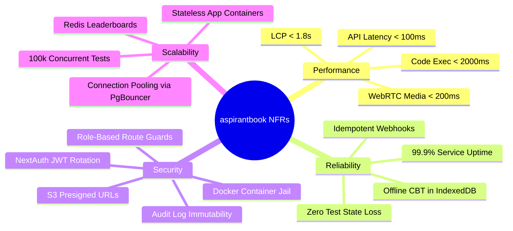
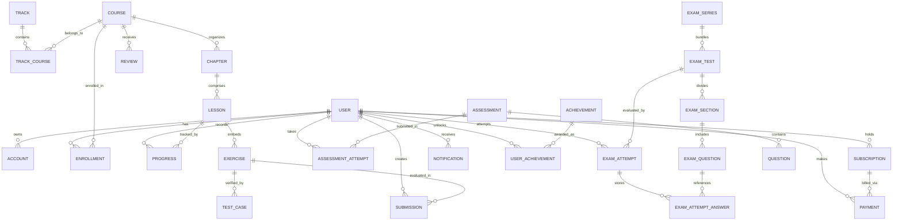
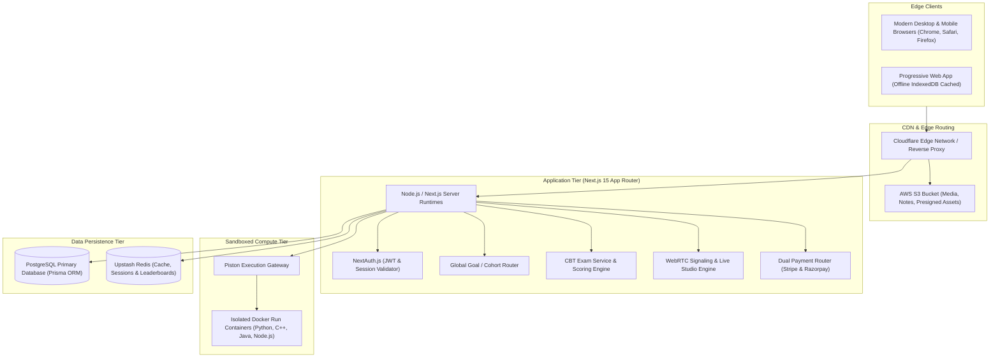
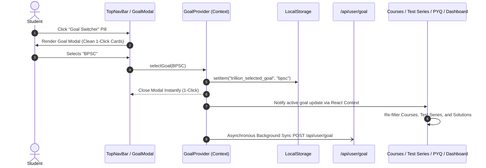
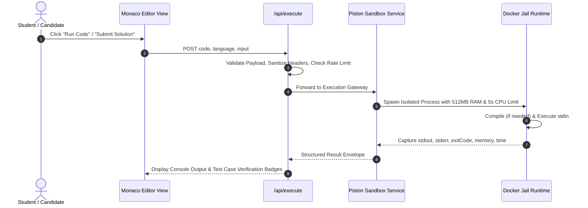
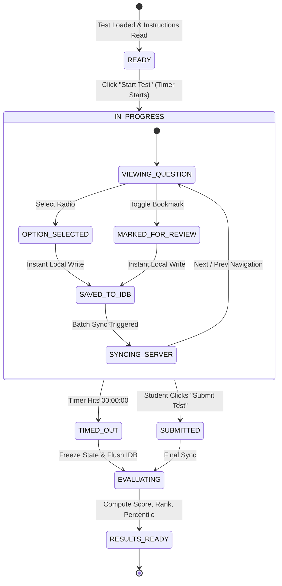
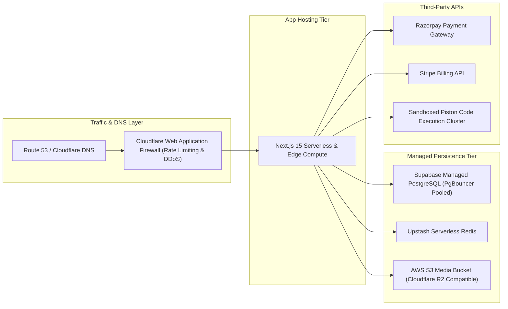

# aspirantbook Platform — Comprehensive System Design & Architecture Specification

> **Document Type:** Production Architecture Specification & System Design  
> **Platform Version:** aspirantbook 2.5 (Next.js 15, PostgreSQL/Prisma, Redis, Docker/Piston, WebRTC)  
> **Status:** Approved Production Standard  
> **Last Updated:** 2026-09-26  

---

## Table of Contents
1. [Functional and Non-Functional Requirements](#1-functional-and-non-functional-requirements)
   - [1.1 Business Objectives & Actors](#11-business-objectives--actors)
   - [1.2 Functional Requirements by Subsystem](#12-functional-requirements-by-subsystem)
   - [1.3 Non-Functional Requirements (NFRs)](#13-non-functional-requirements-nfrs)
2. [Core Entities & Data Modeling (Schema Architecture)](#2-core-entities--data-modeling-schema-architecture)
   - [2.1 Comprehensive Entity-Relationship Diagram](#21-comprehensive-entity-relationship-diagram)
   - [2.2 Data Dictionary & Domain Entities](#22-data-dictionary--domain-entities)
   - [2.3 Indexing, Foreign Keys & Partitioning Strategy](#23-indexing-foreign-keys--partitioning-strategy)
3. [API Design & Interface Specifications](#3-api-design--interface-specifications)
   - [3.1 API Architectural Principles & Response Envelope](#31-api-architectural-principles--response-envelope)
   - [3.2 Authentication & User APIs](#32-authentication--user-apis)
   - [3.3 Global Goal & Cohort APIs](#33-global-goal--cohort-apis)
   - [3.4 CBT Exam & Test Series APIs](#34-cbt-exam--test-series-apis)
   - [3.5 Sandboxed Code Execution APIs](#35-sandboxed-code-execution-apis)
   - [3.6 Live Classroom & WebRTC Signaling APIs](#36-live-classroom--webrtc-signaling-apis)
   - [3.7 Doubts & Academic Mentorship APIs](#37-doubts--academic-mentorship-apis)
   - [3.8 Dual Payment & Webhook APIs](#38-dual-payment--webhook-apis)
   - [3.9 Admin, Batch & Audit APIs](#39-admin-batch--audit-apis)
4. [High-Level Design (HLD) with Architecture Diagrams](#4-high-level-design-hld-with-architecture-diagrams)
   - [4.1 End-to-End System Context Architecture](#41-end-to-end-system-context-architecture)
   - [4.2 Goal Context Switcher & Dynamic Platform Personalization](#42-goal-context-switcher--dynamic-platform-personalization)
   - [4.3 Offline-First CBT Engine Architecture](#43-offline-first-cbt-engine-architecture)
   - [4.4 Sandboxed Code Execution Pipeline](#44-sandboxed-code-execution-pipeline)
   - [4.5 Real-Time WebRTC Live Classroom Architecture](#45-real-time-webrtc-live-classroom-architecture)
   - [4.6 Payment Lifecycle & Webhook Idempotency Machine](#46-payment-lifecycle--webhook-idempotency-machine)
5. [Low-Level Design (LLD) & Implementation Mechanics](#5-low-level-design-lld--implementation-mechanics)
   - [5.1 Component Hierarchy & Client/Server Boundaries](#51-component-hierarchy--clientserver-boundaries)
   - [5.2 State Management & Client Providers](#52-state-management--client-providers)
   - [5.3 CBT Exam Engine State Machine & IndexedDB Syncer](#53-cbt-exam-engine-state-machine--indexeddb-syncer)
   - [5.4 Isolated Code Execution Engine Implementation](#54-isolated-code-execution-engine-implementation)
   - [5.5 Role-Based Access Control (RBAC) & Middleware Pipeline](#55-role-based-access-control-rbac--middleware-pipeline)
6. [Infrastructure, Reliability & Security Topology](#6-infrastructure-reliability--security-topology)
   - [6.1 Production Infrastructure Architecture](#61-production-infrastructure-architecture)
   - [6.2 Caching Strategy & Redis Cache Invalidation](#62-caching-strategy--redis-cache-invalidation)
   - [6.3 Security, Anti-Cheating & Audit Trail Guardrails](#63-security-anti-cheating--audit-trail-guardrails)
   - [6.4 Disaster Recovery & Data Resiliency](#64-disaster-recovery--data-resiliency)

---

## 1. Functional and Non-Functional Requirements

### 1.1 Business Objectives & Actors

aspirantbook is a hybrid Learning Management System (LMS) and Competitive Exam Preparation Platform modeled after high-scale educational ecosystems (e.g., PhysicsWallah / PW, Codecademy, LeetCode, and Testbook). The platform serves multiple distinct user personas:

| Actor | Role Key | Primary Responsibilities & Interactions |
| :--- | :--- | :--- |
| **Student (Free)** | `FREE` | Explores courses, attempts free mock tests, practices coding problems, attends free live broadcasts, asks public doubts. |
| **Student (Premium / Pass)** | `PREMIUM` | Accesses full Pro test series, premium masterclasses, company-tagged interview coding questions, personalized mistake notebooks, and priority faculty doubt support. |
| **Faculty / Educator** | `TEACHER` | Authors questions, creates mock tests, hosts WebRTC live classrooms, launches live polls, reviews student doubts, uploads lecture notes and syllabus resources. |
| **Platform Administrator** | `ADMIN` | Manages users, grants roles, creates batches and career tracks, publishes courses, oversees revenue and audits system actions. |

---

### 1.2 Functional Requirements by Subsystem

#### Subsystem 1: Global Goal / Cohort Context Switcher
- **FR-1.1 (1-Click Goal Finalization):** Users must be able to switch their active learning cohort (e.g., UPSC, BPSC, Class 10th, Skills & Tech, Govt. Exams) in a single click from the global top navigation bar without mandatory micro drill-down steps.
- **FR-1.2 (Omnipresent Personalization):** The platform must immediately reflect the active goal across Courses (`/courses`), Test Series (`/test-series`), Batches (`/batches` & `/my-learning`), Past Question Papers (`/pyqs`), and the Student Dashboard (`/dashboard`).
- **FR-1.3 (Goal Persistence):** The chosen goal must persist in `localStorage`, sync asynchronously with `POST /api/user/goal` for logged-in sessions, and gracefully fall back to default if offline.
- **FR-1.4 (Unrestricted Exploration):** Students must retain the ability to toggle "Show All" on any curated view to explore content outside their primary target goal.

#### Subsystem 2: Learning Management & Course System
- **FR-2.1 (Hierarchical Content Tree):** Content must strictly conform to: `Track` $\rightarrow$ `Course` $\rightarrow$ `Chapter` $\rightarrow$ `Lesson` $\rightarrow$ `Exercise` / `Assessment`.
- **FR-2.2 (Multi-Modal Lesson Formats):** Lessons must support Videos (HLS/MP4), Rich Text / Markdown reading materials, Slides, Code-Alongs, and Interactive Exercises.
- **FR-2.3 (Progress Tracking & Gamification):** Real-time percentage completion calculation, daily learning goal tracking (XP and minutes spent), and dynamic streak calendars.
- **FR-2.4 (Resource Attachments):** Secure storage and delivery of lecture notes, PDF study material, and cheat sheets via S3 presigned URLs.

#### Subsystem 3: CBT (Computer-Based Testing) Exam Engine
- **FR-3.1 (Official Exam Emulation):** Strict alignment with actual government and competitive exam interfaces (BPSC, UPSC CSE, SSC CGL, CBSE Boards) including bilingual (English/Hindi) question switching, question palette (Answered, Marked for Review, Unvisited, Skipped), and sectional timing.
- **FR-3.2 (Negative Marking & Scoring Matrix):** Configurable scoring per test (e.g., $+1.0$ for correct, $-0.33$ for wrong, $0.0$ for unattempted; or board marking schemes).
- **FR-3.3 (Offline-First State Persistence):** Every answer click, marked status, and spent second must save instantly to IndexedDB (`aspirantbook_cbt_store`), syncing to server every 10 seconds or on demand to survive network drops.
- **FR-3.4 (Anti-Cheat Proctoring):** Monitoring of tab switches, window blur events, and full-screen exits with customizable warnings.
- **FR-3.5 (Performance Diagnostics & Leaderboards):** Post-submission analysis featuring All India Rank (AIR), percentile score, topper accuracy comparison, category-wise breakdown, and automated population of the student's personal **Mistake Notebook**.

#### Subsystem 4: Coding Practice & Live Lab Sandbox
- **FR-4.1 (Interactive Monaco Workspace):** Multi-language editor (Python, JavaScript, TypeScript, C++, Java, Go, Rust) with syntax highlighting, autocomplete, and theme support.
- **FR-4.2 (Sandboxed Code Execution):** Secure isolated backend execution via Piston / Docker sandbox evaluating `stdin`, `stdout`, `stderr`, runtime memory, and CPU limits.
- **FR-4.3 (Test Case Validation):** Execution against public sample test cases as well as hidden verification test cases.
- **FR-4.4 (Company Pass Filtering):** Categorized LeetCode-style problem bank tagged by companies (Google, Amazon, Microsoft, TCS, Infosys) with status tracking (Solved, Unsolved, Bookmarked).

#### Subsystem 5: Real-Time Live Classroom (WebRTC)
- **FR-5.1 (Teacher Broadcasting):** One-to-many live streaming of audio, camera feed, and screen sharing using WebRTC peer connections.
- **FR-5.2 (Interactive Chat & Moderation):** Real-time text chat with teacher pinning, doubt tagging, and moderation commands.
- **FR-5.3 (Live In-Class Polls):** Teachers can push multiple-choice polls during lectures; students receive instant modal prompts and aggregated result graphs.
- **FR-5.4 (Hand-Raising & Audio Interactivity):** Students can virtually raise hands; teacher can grant temporary audio streaming rights.

#### Subsystem 6: Academic Doubts & Mentorship Hub
- **FR-6.1 (Multi-Format Question Ingestion):** Students can submit text descriptions, image snapshots of textbooks/code, or PDF documents.
- **FR-6.2 (Faculty Assignment & Resolution):** Verified faculty dashboard for inspecting pending queries, writing formatted mathematical/code answers, and marking doubts as resolved.

#### Subsystem 7: Dual Payment & Subscription Engine
- **FR-7.1 (Dual Payment Gateway):** Razorpay integration for domestic Indian transactions (UPI, Netbanking, Rupay, Wallets) and Stripe integration for international credit/debit cards.
- **FR-7.2 (TrillionPass & Course Subscriptions):** Monthly, yearly, and lifetime passes unlocking all test series and premium courses.
- **FR-7.3 (Idempotent Webhook Processing):** Cryptographic signature validation for Stripe (`stripe-signature`) and Razorpay (`x-razorpay-signature`) with duplicate payment reconciliation.

#### Subsystem 8: Enterprise Administration & Audit
- **FR-8.1 (Role-Based Control):** Strict boundary enforcement between `STUDENT`, `TEACHER`, and `ADMIN`.
- **FR-8.2 (Immutable Audit Logging):** Every role modification, test creation, course publication, and financial event logs actor IP, timestamp, action type, and JSON diffs.

---

### 1.3 Non-Functional Requirements (NFRs)



| Dimension | Metric / Target | Implementation Strategy |
| :--- | :--- | :--- |
| **API Latency** | $P_{95} \le 120\text{ ms}$, $P_{99} \le 250\text{ ms}$ | Prisma query optimization, lean projections (`select`), and Upstash Redis caching for hot entities. |
| **Code Execution Speed** | $\le 2.0\text{ s}$ per standard submission | Pre-warmed container runtimes, strict 512MB RAM cap, and 5s hard CPU timeout. |
| **CBT Concurrency** | 100,000+ simultaneous test takers | Client-side timer execution, local IndexedDB state holding, batch syncing over HTTP keep-alive. |
| **Availability** | $99.9\%$ Service Level Objective (SLO) | Zero-downtime rolling deployments, multi-AZ database failover, and CDN edge caching for static assets. |
| **Data Durability** | $100\%$ zero-loss guarantee for student answers | Immediate synchronous write to IndexedDB before any network dispatch; automatic re-sync on reconnect. |
| **Security & Isolation** | Defense-in-depth | Piston container sandboxing with dropped capabilities (`CAP_SYS_ADMIN`), disabled root user, and network blacklisting during user code execution. |

---

## 2. Core Entities & Data Modeling (Schema Architecture)

### 2.1 Comprehensive Entity-Relationship Diagram



---

### 2.2 Data Dictionary & Domain Entities

#### 1. Identity & Access Domain
- **`User`**: Primary actor record.
  - Attributes: `id` (CUID), `email` (unique index), `password` (hashed with bcrypt), `name`, `image`, `role` (`FREE`, `PREMIUM`, `TEACHER`, `ADMIN`), `xp` (Int), `level` (Int), `streak` (Int), `lastActive` (Timestamp).
- **`Account`**: OAuth federation model linking GitHub/Google providers via NextAuth.

#### 2. Curriculum & LMS Domain
- **`Track`**: Career or skill path roadmap (e.g., *Full-Stack AI Developer*, *State PSC Foundation*).
- **`Course`**: Comprehensive course syllabus with metadata (`difficulty`, `duration`, `status: DRAFT|PUBLISHED|ARCHIVED`, `isPremium`, `technology`, `prerequisites`).
- **`Chapter`**: Sequential unit container holding lessons (`order`, `courseId`).
- **`Lesson`**: Instructional unit (`type: VIDEO|EXERCISE|ASSESSMENT|PROJECT|TUTORIAL|CODE_ALONG|READING`, `videoUrl`, `content`, `slides`, `xpReward`).
- **`Enrollment`**: Many-to-many junction between `User` and `Course` (`enrolledAt`, `completedAt`).
- **`Progress`**: Granular lesson completion tracking with time spent counter (`userId`, `lessonId`, `completed`, `timeSpent`).

#### 3. CBT Test Series Engine Domain
- **`ExamSeries`**: Master package representing an examination series (e.g., *72nd BPSC CCE 2026*, *UPSC Prelims 2026*).
  - Attributes: `title`, `slug` (unique), `examName`, `category`, `isPro`, `totalTests`, `languages`.
- **`ExamTest`**: Individual test instance.
  - Attributes: `testType` (`FULL_MOCK`, `CHAPTER_TEST`, `SECTIONAL_TEST`, `PREVIOUS_YEAR`, `LIVE_SPEED`), `accessMode` (`FREE`, `PRO`), `durationMinutes`, `totalQuestions`, `totalMarks`, `positiveMarks`, `negativeMarks`, `isLive`, `liveStartAt`, `liveEndAt`.
- **`ExamSection`**: Sectional division (e.g., *General Studies Paper 1*, *CSAT Mental Ability*).
  - Attributes: `order`, `positiveMarks`, `negativeMarks`, `timeLimitMins` (optional independent section timer).
- **`ExamQuestion`**: Bilingual question entity.
  - Attributes: `questionType` (`MCQ`, `MSQ`, `NAT`), `questionEn`, `questionHi`, `optionAEn..DEn`, `optionAHi..DHi`, `correctOption`, `explanationEn`, `explanationHi`, `videoUrl`, `difficulty` (`EASY`, `MODERATE`, `HARD`), `subject`, `topic`.
- **`ExamAttempt`**: Student exam sitting record.
  - Attributes: `status` (`IN_PROGRESS`, `SUBMITTED`, `TIMED_OUT`), `score`, `totalMarks`, `correctCount`, `wrongCount`, `skippedCount`, `markedCount`, `timeTakenSecs`, `percentile`, `allIndiaRank`, `tabSwitchCount`.
- **`ExamAttemptAnswer`**: Question-level attempt state.
  - Attributes: `selectedOption`, `isMarked`, `isCorrect`, `marksAwarded`, `timeSpentSecs`. Unique constraint on `[attemptId, questionId]`.

#### 4. Coding Practice & Execution Domain
- **`Exercise`**: Algorithmic coding challenge.
  - Attributes: `slug`, `instructions`, `starterCode`, `solution`, `hints` (array), `language`, `difficulty`, `isPractice`, `category`, `tags`.
- **`TestCase`**: Test case validator (`input`, `expectedOutput`, `isHidden`).
- **`Submission`**: Historical code submission record (`code`, `passed`, `output`, `executionTime`).

#### 5. Payments & Commercials Domain
- **`Subscription`**: Active subscription tier (`plan: FREE|MONTHLY|YEARLY`, `status: ACTIVE|CANCELED|EXPIRED|PAST_DUE`, `provider: STRIPE|RAZORPAY`, `providerId`, `startDate`, `endDate`).
- **`Payment`**: Financial ledger entry (`amount`, `currency`, `status: PENDING|COMPLETED|FAILED|REFUNDED`, `externalId`, `paymentProvider`).
- **`PromoCode`**: Discount vouchers (`discountType: PERCENTAGE|FIXED`, `discountValue`, `maxUses`, `usedCount`).

---

### 2.3 Indexing, Foreign Keys & Partitioning Strategy

```sql
-- Core Production Indexing Definitions
CREATE INDEX idx_user_email_role ON "User" ("email", "role");
CREATE INDEX idx_course_slug_status ON "Course" ("slug", "status", "isPublished");
CREATE INDEX idx_lesson_chapter_order ON "Lesson" ("chapterId", "order");
CREATE INDEX idx_progress_user_lesson ON "Progress" ("userId", "lessonId");
CREATE INDEX idx_exam_attempt_user_test ON "ExamAttempt" ("userId", "testId", "status");
CREATE INDEX idx_exam_attempt_started ON "ExamAttempt" ("startedAt" DESC);
CREATE INDEX idx_exam_attempt_answer_attempt_q ON "ExamAttemptAnswer" ("attemptId", "questionId");
CREATE INDEX idx_payment_user_status ON "Payment" ("userId", "status");
CREATE INDEX idx_audit_log_created_action ON "AuditLog" ("createdAt" DESC, "action");
```

---

## 3. API Design & Interface Specifications

### 3.1 API Architectural Principles & Response Envelope

All API endpoints follow RESTful conventions and return standardized JSON envelopes.

```json
{
  "success": true,
  "data": { ... },
  "message": "Operation completed successfully",
  "meta": {
    "timestamp": "2026-09-26T12:00:00.000Z",
    "requestId": "req_cuid12345"
  }
}
```

Error responses conform to:
```json
{
  "success": false,
  "error": {
    "code": "EXAM_ALREADY_SUBMITTED",
    "message": "This assessment attempt has already been finalized.",
    "details": null
  }
}
```

---

### 3.2 Authentication & User APIs

| Method | Endpoint | Description | Auth Required |
| :--- | :--- | :--- | :--- |
| `POST` | `/api/auth/[...nextauth]` | Session token creation, OAuth callbacks, credentials sign-in. | Public |
| `GET` | `/api/auth/role` | Retrieves authenticated user role, subscription tier, and permissions. | Authenticated |
| `GET` | `/api/user/goal` | Fetches active selected goal ID and preferences. | Optional |
| `POST` | `/api/user/goal` | Updates user's persisted active target goal. | Authenticated |

---

### 3.3 Global Goal & Cohort APIs

#### `GET /api/goals`
- **Description:** Returns the complete goal hierarchy including popular goals, categories, and foundation series.
- **Cache Policy:** `Cache-Control: public, s-maxage=3600, stale-while-revalidate=86400`.
- **Response Schema:**
  ```json
  {
    "success": true,
    "data": {
      "popularGoals": [
        { "id": "upsc", "name": "UPSC", "fullName": "UPSC Civil Services Examination", "tags": ["upsc", "civil-services"] },
        { "id": "bpsc", "name": "BPSC", "fullName": "Bihar Public Service Commission", "tags": ["bpsc", "state-psc"] }
      ],
      "categories": [ ... ],
      "otherOfferings": [ ... ]
    }
  }
  ```

---

### 3.4 CBT Exam & Test Series APIs

#### `POST /api/exam/attempt/start`
- **Description:** Initializes an exam attempt session, provisions server-side timer, and returns secure attempt token.
- **Request Body:**
  ```json
  { "testId": "bpsc-72nd-2026", "language": "Hindi" }
  ```
- **Response:**
  ```json
  {
    "success": true,
    "data": {
      "attemptId": "att_cuid9876",
      "testId": "bpsc-72nd-2026",
      "durationMinutes": 120,
      "totalQuestions": 150,
      "startedAt": "2026-09-26T12:00:00.000Z"
    }
  }
  ```

#### `POST /api/exam/attempt/[attemptId]/sync`
- **Description:** Batch syncs uncommitted answers from client IndexedDB queue.
- **Request Body:**
  ```json
  {
    "answers": [
      { "questionId": "q101", "selectedOption": "A", "isMarked": false, "timeSpentSecs": 42 },
      { "questionId": "q102", "selectedOption": null, "isMarked": true, "timeSpentSecs": 18 }
    ],
    "clientTimestamp": "2026-09-26T12:05:00.000Z",
    "tabSwitchCount": 0
  }
  ```

#### `POST /api/exam/attempt/[attemptId]/submit`
- **Description:** Finalizes exam attempt, evaluates score, percentile, and rank, and closes session.
- **Response:** Includes detailed statistics, score, accuracy, and rank estimate.

---

### 3.5 Sandboxed Code Execution APIs

#### `POST /api/execute`
- **Description:** Executes source code against Piston sandbox runtime with timeout controls.
- **Request Body:**
  ```json
  {
    "language": "python",
    "version": "3.10.0",
    "sourceCode": "def solution(arr):\n    return sorted(arr)",
    "stdin": "[3, 1, 2]"
  }
  ```
- **Response:**
  ```json
  {
    "success": true,
    "data": {
      "stdout": "[1, 2, 3]\n",
      "stderr": null,
      "exitCode": 0,
      "executionTimeMs": 48,
      "memoryUsageBytes": 14208000
    }
  }
  ```

---

### 3.6 Live Classroom & WebRTC Signaling APIs

- `GET /api/classroom/[id]`: Fetches classroom status, active instructor, and schedule.
- `POST /api/classroom/[id]/authorize`: Issues signed WebRTC SDP / ICE session token for broadcaster or viewer.
- `GET /api/classroom/[id]/chat` & `POST /api/classroom/[id]/chat`: Polled/WebSocket messaging channel.
- `POST /api/classroom/[id]/polls`: Teacher poll push and student vote submission.
- `POST /api/classroom/[id]/hand-raise`: Student queue management for live question asking.

---

### 3.7 Dual Payment & Webhook APIs

- `POST /api/checkout/razorpay`: Generates cryptographically signed Razorpay Order ID.
- `POST /api/verify-payment/razorpay`: Verifies HMAC SHA-256 signature (`razorpay_order_id|razorpay_payment_id`).
- `POST /api/checkout`: Creates Stripe Checkout Session.
- `POST /api/webhooks/stripe`: Ingests and reconciles asynchronous Stripe subscription events (`checkout.session.completed`, `invoice.payment_failed`).
- `POST /api/webhooks/razorpay`: Reconciles Razorpay captured charges and refunds.

---

## 4. High-Level Design (HLD) with Architecture Diagrams

### 4.1 End-to-End System Context Architecture



---

### 4.2 Goal Context Switcher & Dynamic Platform Personalization

The Global Goal Switcher follows an instantaneous, zero-latency reactive loop:



---

### 4.3 Offline-First CBT Engine Architecture

To ensure total resilience against internet drops during 2-hour long competitive examinations, the CBT engine uses a double-buffer storage strategy:

```mermaid
flowchart TD
    subgraph ClientApp["Student Browser Runtime"]
        UserAction["Student Selects Option / Marks Review"]
        IDBStorage[("IndexedDB (aspirantbook_cbt_store)")]
        SyncManager["SyncManager (Periodic Heartbeat & Flush)"]
    end

    subgraph ServerBackend["Next.js Server Cluster"]
        SyncAPI["POST /api/exam/attempt/[id]/sync"]
        SubmitAPI["POST /api/exam/attempt/[id]/submit"]
        PostgresDB[("PostgreSQL ExamAttemptAnswer")]
    end

    UserAction -->|1. Immediate Sync Write| IDBStorage
    IDBStorage -->|2. Read Unsynced Batch| SyncManager
    SyncManager -->|3. Batch Sync (Every 10s or Page Blur)| SyncAPI
    SyncAPI -->|4. UPSERT into DB| PostgresDB
    SyncAPI -->>|5. ACK Committed IDs| SyncManager
    SyncManager -->|6. Mark Synced in IDB| IDBStorage

    UserAction -.->|On Final Click| SubmitAPI
    SubmitAPI --> PostgresDB
```

---

### 4.4 Sandboxed Code Execution Pipeline



---

## 5. Low-Level Design (LLD) & Implementation Mechanics

### 5.1 Component Hierarchy & Client/Server Boundaries

The Next.js 15 architecture strategically divides Server Components (RSC) and Client Components (`"use client"`):

```
app/
├── (dashboard)/                     [Server Layout with Auth & Nav]
│   ├── layout.tsx                   [RSC: Session fetch, LeftSidebar, TopNavBar]
│   ├── courses/
│   │   ├── page.tsx                 [RSC: Fetches DB courses + ALL_GOAL_COURSES]
│   │   └── CourseClient.tsx         [Client: useGoal(), Goal Banner, Tabs, Filters]
│   ├── test-series/
│   │   └── page.tsx                 [Client: useGoal(), TEST_SERIES_DATA, Mocks Filter]
│   ├── practice/
│   │   ├── page.tsx                 [RSC: Practice metadata wrapper]
│   │   └── CodingPracticeView.tsx   [Client: Monaco runner, problem list, filters]
│   ├── pyqs/
│   │   └── page.tsx                 [Client: Dynamic redirect to active goal PYQ]
│   └── dashboard/
│       ├── page.tsx                 [RSC: Database metrics & progress loader]
│       └── StudentDashboardClient.tsx [Client: useGoal(), live class, batch pills]
└── (exam)/
    └── test-series/[id]/
        ├── page.tsx                 [Client: Fullscreen CBT Examination Engine]
        └── solutions/
            └── page.tsx             [Client: Dynamic Question Bank, Mistake Notebook]
```

---

### 5.2 State Management & Client Providers

The application state tree is managed via React Context providers in `components/providers/`:
- **`GoalProvider` (`useGoal()`):**
  - Manages `selectedGoal`, `selectedSubGoal`, `allGoalsConfig`, `isGoalModalOpen`.
  - Exposes `selectGoal(goal, subGoal?)`, `openGoalModal()`, and `closeGoalModal()`.
  - Persists selection to `localStorage` and background API sync.
- **`SessionProvider` (`useSession()`):** NextAuth authentication provider maintaining JWT identity and authentic role.
- **`ThemeClient`:** Handles dark/light theme tokens and persists mode preferences without screen flicker.

---

### 5.3 CBT Exam Engine State Machine & IndexedDB Syncer

The state machine governing a test attempt transition is formalized as follows:



---

### 5.4 Isolated Code Execution Engine Implementation

File: `lib/execution/piston.ts`

```typescript
export interface PistonExecutionResult {
    language: string
    version: string
    run: {
        stdout: string
        stderr: string
        output: string
        code: number
        signal: string | null
    }
}

export async function executeCodeOnPiston(
    language: string,
    sourceCode: string,
    stdin: string = ""
): Promise<PistonExecutionResult> {
    const PISTON_API_URL = process.env.PISTON_API_URL || "https://emkc.org/api/v2/piston"

    const response = await fetch(`${PISTON_API_URL}/execute`, {
        method: "POST",
        headers: { "Content-Type": "application/json" },
        body: JSON.stringify({
            language,
            version: "*",
            files: [{ content: sourceCode }],
            stdin,
            run_timeout: 5000,
            compile_timeout: 10000,
        }),
    })

    if (!response.ok) {
        throw new Error(`Execution engine error: ${response.statusText}`)
    }

    return response.json()
}
```

---

### 5.5 Role-Based Access Control (RBAC) & Middleware Pipeline

File: `lib/auth/rbac.ts`

```typescript
export type Permission =
    | "course:view"
    | "course:create"
    | "course:publish"
    | "exam:attempt_free"
    | "exam:attempt_pro"
    | "exam:create"
    | "batch:manage"
    | "audit:view"
    | "user:manage"

export const ROLE_PERMISSIONS: Record<string, Permission[]> = {
    FREE: ["course:view", "exam:attempt_free"],
    PREMIUM: ["course:view", "exam:attempt_free", "exam:attempt_pro"],
    TEACHER: [
        "course:view",
        "course:create",
        "exam:attempt_free",
        "exam:attempt_pro",
        "exam:create",
        "batch:manage"
    ],
    ADMIN: [
        "course:view",
        "course:create",
        "course:publish",
        "exam:attempt_free",
        "exam:attempt_pro",
        "exam:create",
        "batch:manage",
        "audit:view",
        "user:manage"
    ]
}

export function hasPermission(userRole: string, permission: Permission): boolean {
    const permissions = ROLE_PERMISSIONS[userRole] || []
    return permissions.includes(permission)
}
```

---

## 6. Infrastructure, Reliability & Security Topology

### 6.1 Production Infrastructure Architecture



---

### 6.2 Caching Strategy & Redis Cache Invalidation

1. **Course & Test Metadata:** Cached with 1-hour TTL. Invalidated via Next.js `revalidatePath("/courses")` and `revalidatePath("/test-series")` upon teacher/admin mutation.
2. **Live Leaderboards:** Stored in Redis Sorted Sets (`ZADD exam:leaderboard:<testId> <score> <userId>`). Querying Top 100 via `ZREVRANGE` achieves sub-5ms retrieval.
3. **User Entitlements & Roles:** Cached in signed JWT session tokens, refreshed on token rotation every 24 hours or immediately following successful payment webhook processing.

---

### 6.3 Security, Anti-Cheating & Audit Trail Guardrails

- **Zero Client Trust:** Timer calculation on CBT exams is tracked both client-side and verified against `ExamAttempt.startedAt` + `durationMinutes` on the server during submission.
- **Tab-Switch Auditing:** `visibilitychange` browser events trigger an increment to `tabSwitchCount`. When thresholds are exceeded, the exam auto-submits.
- **Content Security Policy (CSP):** Strict script, frame, and media policies preventing cross-site scripting (XSS) and unauthorized iframe embedding.
- **Database Immutability:** `AuditLog` rows cannot be modified or deleted once inserted (`UPDATE` and `DELETE` queries rejected at database trigger level).

---

### 6.4 Disaster Recovery & Data Resiliency

| Failure Scenario | Automated Recovery / Mitigation Strategy |
| :--- | :--- |
| **Database Network Outage** | Application switches to pre-cached in-memory fallback datasets ([goal-courses-data.ts](file:///Users/praveenkumar/aspirantbook/lib/goal-courses-data.ts), mock tests) to keep the student UI functional. |
| **Student Network Disconnection during Exam** | Local browser continues ticking via IndexedDB buffer; background sync resumes automatically when `navigator.onLine` turns true. |
| **Payment Webhook Drop** | Payment verification fallback reconciles transactions on redirect via `verify-payment/razorpay` and Stripe `checkout.session.completed` retrieval. |
| **Sandbox Hang / Fork Bomb** | Piston engine limits CPU to 5 seconds and maximum memory to 512MB per process, terminating aberrant scripts immediately. |

---

*End of Architecture Specification.*
