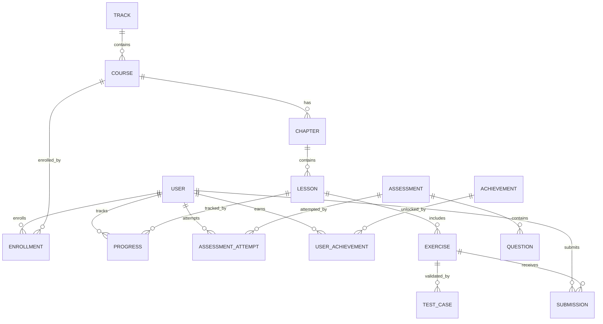

# aspirantbook Platform - Master System Design Document

> **CRITICAL REFERENCE**: This document is the SINGLE SOURCE OF TRUTH for the platform's design, architecture, and flows.  
> **Last Updated**: November 25, 2025  
> **Status**: Active Development

---

## 🎯 Platform Overview

**aspirantbook** is an **interactive learning platform** for Data Science, AI, and Programming. It consists of:

1. **Student Portal** - Learning interface for students (PRIMARY FOCUS)
2. **Admin Portal** - Content management for instructors/admins

---

## 🏗️ System Architecture

### High-Level Architecture

```
┌─────────────────────────────────────────────────────────────┐
│                     CLIENT LAYER                             │
│  ┌──────────────┐              ┌──────────────┐            │
│  │    Student   │              │    Admin     │            │
│  │    Portal    │              │    Portal    │            │
│  │  (Next.js)   │              │  (Next.js)   │            │
│  └──────┬───────┘              └──────┬───────┘            │
└─────────┼──────────────────────────────┼───────────────────┘
          │                              │
          └──────────────┬───────────────┘
                         │
          ┌──────────────▼─────────────────┐
          │    APPLICATION LAYER            │
          │  ┌──────────────────────────┐  │
          │  │  Next.js Server Actions  │  │
          │  │  (API Logic)             │  │
          │  └────────┬─────────────────┘  │
          └───────────┼─────────────────────┘
                      │
       ┌──────────────┼──────────────┐
       │              │              │
┌──────▼─────┐ ┌─────▼──────┐ ┌─────▼──────┐
│ PostgreSQL │ │   Redis    │ │    S3      │
│  (Primary) │ │  (Cache)   │ │ (Storage)  │
└────────────┘ └────────────┘ └────────────┘
       │
┌──────▼─────────────────────────────────┐
│    CODE EXECUTION ENGINE (Docker)      │
│  Python | JavaScript | SQL | R         │
└────────────────────────────────────────┘
```

### Tech Stack

| Layer | Technology | Purpose |
|-------|------------|---------|
| **Frontend** | Next.js 14 (App Router) | SSR, RSC, Client components |
| **Styling** | Tailwind CSS + Shadcn UI | Utility-first styling + components |
| **Backend** | Next.js Server Actions | Type-safe API without separate backend |
| **Database** | PostgreSQL + Prisma ORM | Relational data with type safety |
| **Caching** | Redis (Upstash) | Leaderboards, session cache |
| **Storage** | AWS S3 | Videos, PDFs, images |
| **Auth** | NextAuth.js | OAuth + Credentials |
| **Code Execution** | Docker (Sandboxed) | Isolated code runner |
| **Monitoring** | (Planned) Sentry | Error tracking |
| **Payments** | (Planned) Stripe/Razorpay | Subscriptions |

---

## 📊 Database Architecture

### Core Models & Relationships



### Key Models

#### User Management
- **User** - Core user entity (FREE, PREMIUM, ADMIN roles)
- **Account** - OAuth provider accounts
- **Subscription** - Payment plans
- **Payment** - Transaction records

#### Content Hierarchy
- **Track** - Career/Skill learning paths
- **Course** - Individual courses
- **Chapter** - Course sections
- **Lesson** - Learning units (VIDEO, EXERCISE, ASSESSMENT, etc.)

#### Interactive Learning
- **Exercise** - Coding challenges
- **TestCase** - Exercise validation
- **Submission** - Student code submissions
- **Assessment** - Quizzes/tests
- **Question** - Assessment questions (MCQ, Code, Fill-blank)
- **AssessmentAttempt** - Student quiz attempts

#### Progress & Gamification
- **Progress** - Lesson completion tracking
- **Achievement** - Badges/milestones
- **UserAchievement** - Unlocked achievements
- **UserAnalytics** - Daily activity metrics
- **CourseAnalytics** - Course performance metrics

---

## 👨‍🎓 STUDENT PORTAL - Complete User Flow

### 1. Authentication & Onboarding

```
┌─────────────┐
│  Landing    │
│  Page       │
└──────┬──────┘
       │
       ├─→ Sign Up (Email/Google/GitHub)
       │   └─→ Email verification
       │       └─→ Interest selection
       │           └─→ Recommended tracks
       │
       └─→ Login
           └─→ Dashboard
```

### 2. Dashboard (Home Page)

**Page**: `/` (Student Dashboard)

**Components**:
- **Welcome Banner**
  - Personalized greeting (time-based)
  - Current level badge
  - Daily streak counter (with fire icon)
  
- **Stats Row**
  - XP progress (circular ring)
  - Courses enrolled
  - Lessons completed
  - Current streak
  
- **Continue Learning Section**
  - Recently accessed courses
  - Progress bars for each
  - "Resume" CTA buttons
  
- **Recommended Courses Carousel**
  - Personalized suggestions
  - Course cards with ratings
  
- **Activity Feed**
  - Recent lesson completions
  - Achievements unlocked
  - Assessment scores
  
- **Quick Actions**
  - Start daily challenge
  - View leaderboard
  - Browse courses

**Data Flow**:
```typescript
// Server Component
const user = await getUserWithStats(userId)
const enrollments = await getActiveEnrollments(userId)
const recommendations = await getRecommendedCourses(userId)
const activities = await getRecentActivity(userId)

// Display with client components for interactivity
```

### 3. Course Discovery Flow

**Page**: `/courses`

**Features**:
- **Filter Sidebar**
  - Technology (Python, JavaScript, SQL, etc.)
  - Difficulty (Beginner, Intermediate, Advanced)
  - Duration (< 5hrs, 5-10hrs, 10+ hrs)
  - Type (Free, Premium)
  
- **Search Bar**
  - Autocomplete suggestions
  - Recent searches
  
- **Course Grid**
  - Thumbnail images
  - Title, instructor, rating
  - Difficulty badge
  - Duration
  - Enrollment count
  - "Enroll" or "Continue" button
  
- **Tabs**
  - All Courses
  - My Courses (Enrolled)
  - Completed
  - Bookmarked

**User Actions**:
1. Browse/Search courses
2. Apply filters
3. Click course → Course Overview
4. Enroll → Added to "My Courses"

### 4. Course Overview Page

**Page**: `/courses/[slug]`

**Layout**:
- **Header Section**
  - Large thumbnail
  - Course title
  - Instructor info
  - Star rating (avg + count)
  - **PROMINENT "Enroll" or "Continue Learning" button**
  - Share button
  - Bookmark icon
  
- **Stats Bar**
  - 👥 X students enrolled
  - ⏱️ X hours total
  - 📊 Difficulty level
  
- **Tabs**:
  1. **Overview**
     - "What You'll Learn" (checkmark list)
     - Prerequisites (linked courses)
     - Instructor bio
     
  2. **Syllabus**
     - Expandable chapters
     - Lesson list with:
       - Type icon (🎥 Video, 💻 Exercise, 📝 Assessment)
       - Duration
       - Lock/unlock status
       - Completion checkmark
     
  3. **Reviews**
     - Star ratings distribution
     - Student reviews (paginated)
     - Write review (if enrolled)
     
  4. **Progress** (if enrolled)
     - Circular progress chart
     - Lessons completed
     - XP earned
     - Time spent

**User Actions**:
1. View course details
2. Click "Enroll" → Creates Enrollment record
3. Click "Start Learning" → Navigate to first lesson
4. Check prerequisites → Navigate to required courses

### 5. Learning Interface (Lesson View)

**Page**: `/courses/[slug]/learn/[lessonId]`

**Layout Structure**:
```
┌─────────────────────────────────────────────────────┐
│              Top Navigation Bar                      │
│  [← Back to Course]    Lesson Title    [Next →]    │
└─────────────────────────────────────────────────────┘
│                                                      │
│  ┌──────────────┐  ┌──────────────────────────┐   │
│  │   Sidebar    │  │    Main Content Area      │   │
│  │              │  │                            │   │
│  │  Chapters    │  │   [Video Player / Content] │   │
│  │  ├─ Ch 1     │  │                            │   │
│  │  │  ├─ L1 ✓  │  │   [Tabs: Overview |        │   │
│  │  │  ├─ L2 ✓  │  │         Resources |        │   │
│  │  │  └─ L3 →  │  │         Notes |            │   │
│  │  └─ Ch 2 🔒  │  │         Discussion]        │   │
│  │              │  │                            │   │
│  │  [Progress]  │  │   [Mark Complete Button]   │   │
│  │  60% ●●●●○○  │  │                            │   │
│  └──────────────┘  └──────────────────────────┘   │
└─────────────────────────────────────────────────────┘
```

**Lesson Types**:

1. **VIDEO Lesson**
   - Embedded YouTube/Vimeo player
   - Playback speed controls
   - Transcript (if available)
   
2. **READING Lesson**
   - Markdown-rendered content
   - Code syntax highlighting
   - Images/diagrams
   
3. **EXERCISE Lesson**
   - Redirects to Practice Environment (see below)
   
4. **ASSESSMENT Lesson**
   - Redirects to Assessment Interface (see below)

**Sidebar Features**:
- Collapsible chapters
- ✓ Checkmarks for completed lessons
- 🔒 Lock icons for locked lessons
- → Arrow for current lesson
- Overall progress percentage

**Tab Content**:
1. **Overview** - Lesson description, learning objectives
2. **Resources** - Downloadable files (PDFs, datasets, code)
3. **Notes** - Personal notes (rich text editor, saved to DB)
4. **Discussion** - Q&A thread for this lesson

**User Actions**:
1. Watch video / Read content
2. Take notes
3. Download resources
4. Ask questions in discussion
5. Click "Mark Complete" → Updates Progress table
6. Navigate to next lesson

**Data Flow**:
```typescript
// Mark lesson complete
await prisma.progress.upsert({
  where: { userId_lessonId },
  update: { completed: true, timeSpent: duration },
  create: { userId, lessonId, completed: true }
})

// Award XP
await prisma.user.update({
  where: { id: userId },
  data: { xp: { increment: lesson.xpReward } }
})

// Check for achievements
await checkAchievementUnlocks(userId)

// Update analytics
await updateUserAnalytics(userId, { lessonsCompleted: 1 })
```

### 6. Practice Environment (Code Exercises)

**Page**: `/practice/[exerciseId]` or embedded in lesson

**Layout**: Three-Panel Split
```
┌───────────────────────────────────────────────────────────┐
│  [Language: Python ▼]  [Run Code]  [Submit]  [Reset]      │
├───────────┬─────────────────────┬─────────────────────────┤
│           │                     │                         │
│ Problem   │   Code Editor       │   Console / Output      │
│ Statement │   (Monaco)          │                         │
│           │                     │   [Test Cases]          │
│ ─────     │                     │   ✓ Sample Test 1       │
│ Hints ▼   │                     │   ✓ Sample Test 2       │
│ • Hint 1  │                     │   ✗ Hidden Test 3       │
│           │                     │                         │
│           │                     │   Execution: 45ms       │
└───────────┴─────────────────────┴─────────────────────────┘
```

**Features**:
- **Problem Panel** (Left)
  - Markdown-rendered instructions
  - Input/output examples
  - Constraints
  - Collapsible hints
  
- **Code Editor** (Center)
  - Monaco editor (VS Code engine)
  - Syntax highlighting
  - Autocomplete
  - Pre-loaded starter code
  - Font size controls
  
- **Console Panel** (Right)
  - Real-time output
  - Test results (pass/fail indicators)
  - Execution time
  - Memory usage
  - Error messages (syntax, runtime)

**Workflow**:
1. User reads problem
2. Writes code in editor
3. Clicks "Run Code"
   - Code sent to Docker sandbox
   - Runs against sample test cases
   - Results displayed in console
4. Clicks "Submit"
   - Runs against ALL test cases (including hidden)
   - If all pass → Success animation + XP award
   - If fail → Show which tests failed

**Data Flow**:
```typescript
// Run code (Sample tests only)
const result = await executeCode({
  code: userCode,
  language: 'python',
  testCases: exercise.testCases.filter(tc => !tc.isHidden)
})

// Submit solution (All tests)
const submission = await executeCode({
  code: userCode,
  language: 'python',
  testCases: exercise.testCases // All tests
})

await prisma.submission.create({
  data: {
    userId,
    exerciseId,
    code: userCode,
    passed: submission.allPassed,
    output: submission.results,
    executionTime: submission.avgTime
  }
})

if (submission.allPassed) {
  await awardXP(userId, exercise.xpReward)
  await checkAchievements(userId)
}
```

### 7. Assessment System

**Page**: `/assessments/[assessmentId]`

**Pre-Assessment Screen**:
- Assessment title
- Description
- Duration (e.g., 30 minutes)
- Total questions (e.g., 20)
- Passing score (e.g., 70%)
- **"Start Assessment" button**

**During Assessment**:
```
┌─────────────────────────────────────────────────────┐
│  Question 5/20          Time Remaining: 24:15        │
├─────────────────────────────────────────────────────┤
│                                                      │
│  What is the output of the following code?          │
│                                                      │
│  ```python                                          │
│  x = [1, 2, 3]                                      │
│  print(x[1:])                                       │
│  ```                                                │
│                                                      │
│  ○ [1, 2, 3]                                        │
│  ○ [2, 3]       ← Selected                          │
│  ○ [1, 2]                                           │
│  ○ [3]                                              │
│                                                      │
│  [Flag for Review]                                  │
│                                                      │
│  [← Previous]              [Next →]    [Submit]     │
└─────────────────────────────────────────────────────┘
│  Question Palette:                                  │
│  [1✓][2✓][3✓][4✓][5●][6 ][7 ][8 ][9⚑][10 ]...      │
│  ✓ Answered  ● Current  ⚑ Flagged  □ Unanswered    │
└─────────────────────────────────────────────────────┘
```

**Question Types**:
1. **MULTIPLE_CHOICE** - Radio buttons
2. **CODE_OUTPUT** - Predict code output
3. **FILL_BLANK** - Text input
4. **TRUE_FALSE** - Boolean choice
5. **CODE_COMPLETION** - Fill missing code

**Features**:
- Countdown timer (auto-submit at 0:00)
- Question palette for quick navigation
- Flag questions for review
- Auto-save answers (stored in session)
- Submit confirmation dialog

**Post-Assessment (Results Page)**:
```
┌─────────────────────────────────────────────────────┐
│              🎉 Assessment Complete!                │
├─────────────────────────────────────────────────────┤
│                                                      │
│              Score: 85/100 (17/20)                  │
│                    ✅ PASSED                         │
│                                                      │
│  ────────────────────────────────────────────────  │
│                                                      │
│  Time Taken: 24 min 35 sec                         │
│  Passing Score: 70%                                 │
│                                                      │
│  ✓ Correct: 17                                     │
│  ✗ Incorrect: 3                                    │
│                                                      │
│  [View Detailed Results] [Retake Assessment]       │
└─────────────────────────────────────────────────────┘
```

**Detailed Results**:
- Question-by-question review
- User's answer vs correct answer
- Explanation for each question
- Save attempt to database

**Data Flow**:
```typescript
// Start assessment
const attempt = await prisma.assessmentAttempt.create({
  data: {
    userId,
    assessmentId,
    startedAt: new Date(),
    answers: {}
  }
})

// Auto-save answers (every 10 seconds)
await prisma.assessmentAttempt.update({
  where: { id: attemptId },
  data: { answers: currentAnswers }
})

// Submit assessment
const { score, passed } = calculateScore(answers, questions)

await prisma.assessmentAttempt.update({
  where: { id: attemptId },
  data: {
    score,
    passed,
    completedAt: new Date(),
    timeSpent: elapsed
  }
})

if (passed) {
  await awardCertificate(userId, assessmentId)
}
```

### 8. Progress & Analytics Dashboard

**Page**: `/profile/progress`

**Sections**:

1. **Overview Card**
   - Total XP (large number)
   - Current level + progress to next
   - Learning streak (🔥 X days)
   
2. **XP Timeline Graph**
   - Line chart showing XP earned over time
   - Daily/Weekly/Monthly view
   
3. **Study Time Heatmap**
   - GitHub-style contribution graph
   - Shows daily study minutes
   
4. **Course Progress**
   - List of enrolled courses
   - Circular progress for each
   - Chapters completed / total
   - Lessons completed / total
   - Exercises solved / total
   
5. **Skills Radar Chart**
   - Spider chart showing proficiency in:
     - Python, JavaScript, SQL, Data Science, ML, etc.
   - Based on completed exercises/assessments
   
6. **Achievements Gallery**
   - Grid of earned badges
   - Locked achievements (grayed out)
   
7. **Certificates**
   - Earned certificates (downloadable PDFs)
   - Shareable links

### 9. Leaderboard

**Page**: `/leaderboard`

**Layout**:
```
┌─────────────────────────────────────────────────────┐
│  [Global] [Friends] [Course: Python Basics ▼]       │
│  [This Week ▼] [This Month] [All Time]              │
├─────────────────────────────────────────────────────┤
│                  🏆 TOP 3 🏆                         │
│       ┌───┐     ┌───┐     ┌───┐                    │
│   2nd │   │ 1st │   │ 3rd │   │                    │
│       └───┘     └───┘     └───┘                    │
│      Alice     Bob      Charlie                     │
│     2,450 XP  3,100 XP  2,200 XP                   │
├─────────────────────────────────────────────────────┤
│  Rank | User      | XP     | Level | Trend         │
│  ─────┼───────────┼────────┼───────┼──────         │
│    4  | David     | 2,100  |   5   | ↑ +2          │
│    5  | YOU       | 1,950  |   4   | ↓ -1          │ ← Highlighted
│    6  | Emma      | 1,800  |   4   | →  0          │
│   ... | ...       | ...    |  ...  | ...           │
└─────────────────────────────────────────────────────┘
```

**Features**:
- **Tabs**: Global, Friends, Course-specific
- **Time Period**: Week, Month, All-time
- **Podium Display** for top 3 (special styling)
- **Rank Trends**: Up/down arrows showing rank change
- **Current User Highlighting**
- Pagination for large datasets

**Data Source**:
```typescript
// Redis sorted set for fast rankings
await redis.zadd('leaderboard:global:week', xp, userId)
const rankings = await redis.zrevrange('leaderboard:global:week', 0, 99, 'WITHSCORES')
```

### 10. User Profile & Settings

**Page**: `/profile`

**Profile Tab**:
- Cover photo (uploadable)
- Avatar (uploadable)
- Name, bio, location
- Social links (GitHub, LinkedIn, Twitter)
- Join date
- Following / Followers count
- **Tabs**:
  1. Overview - Enrolled courses, achievements
  2. Activity - Recent submissions, assessments
  3. Certificates - Earned certificates
  4. Skills - Skills breakdown

**Settings Page**: `/settings`
- **Account**: Email, password, phone
- **Preferences**: Language, timezone
- **Notifications**:
  - Email notifications (on/off)
  - Push notifications
  - Notification types (course updates, achievements, etc.)
- **Privacy**: Profile visibility, data sharing
- **Subscription**: Plan details, billing, upgrade/cancel
- **Danger Zone**: Delete account

### 11. Additional Student Features

**My Library** (`/library`):
- Tabs: In Progress, Completed, Bookmarked
- Search and filter
- Course cards with progress

**Tracks** (`/tracks`):
- Visual roadmap (node graph)
- Career tracks (Data Scientist, ML Engineer, etc.)
- Skill tracks (Python Mastery, SQL Expert, etc.)
- Progress through track
- Locked/unlocked courses

**Practice Hub** (`/practice`):
- Browse all exercises
- Filter by difficulty, topic
- Daily challenge

**Tutorials** (`/tutorials`):
- Step-by-step guides
- Interactive walkthroughs

**Projects** (`/projects`):
- End-to-end projects
- Submit project code
- Peer reviews

**Code-Along** (`/code-along`):
- Live coding sessions
- Follow instructor in real-time

**AI Chatbot** (Floating button):
- Context-aware help
- Explain code snippets
- Answer questions about lessons

---

## 🔧 ADMIN PORTAL - User Flow

### Admin Dashboard (`/admin`)
- Overview stats (total users, courses, revenue)
- Recent activity

### Course Management
1. **Create Course** (`/admin/courses/create`)
2. **Edit Course** (`/admin/courses/[id]/edit`)
   - Add/edit chapters
   - Add/edit lessons
   - Reorder content
3. **Publish Course** (status: DRAFT → PUBLISHED)

### Exercise Management
1. **Create Exercise** (`/admin/exercises/create`)
   - Title, instructions (Markdown)
   - Starter code, solution
   - Test cases (input, expected output, hidden flag)
2. **Edit Exercise**

### Assessment Management
1. **Create Assessment** (`/admin/assessments/create`)
   - Add questions
   - Set duration, passing score
2. **Question Builder**
   - Question type selector
   - Answer options
   - Correct answer
   - Explanation

### User Management (`/admin/users`)
- View all users
- Change roles
- Ban/unban users
- Enroll users manually

### Analytics (`/admin/analytics`)
- Revenue metrics
- Course performance
- User engagement
- Enrollment trends

---

## 🔄 Critical Data Flows

### 1. Content Publishing Flow
```
Admin creates course (DRAFT)
  ↓
Admin adds chapters & lessons
  ↓
Admin publishes course (PUBLISHED)
  ↓
Student sees course in catalog
  ↓
Student enrolls
  ↓
Enrollment record created
  ↓
Student can access lessons
```

### 2. Learning Progress Flow
```
Student starts lesson
  ↓
Progress record created (completed: false)
  ↓
Student completes lesson
  ↓
Progress updated (completed: true)
  ↓
User XP incremented
  ↓
Check achievement conditions
  ↓
If unlocked → UserAchievement created
  ↓
Notification sent
  ↓
Leaderboard updated (Redis)
```

### 3. Code Execution Flow
```
Student writes code
  ↓
Clicks "Run Code"
  ↓
Server Action receives code + test cases
  ↓
Code sent to Docker container
  ↓
Container executes code (timeout: 10s)
  ↓
Results captured (stdout, stderr, exit code)
  ↓
Results compared with expected output
  ↓
Pass/fail status returned
  ↓
If "Submit" and all pass:
  ↓
Submission record created
  ↓
XP awarded
```

### 4. Assessment Flow
```
Student starts assessment
  ↓
AssessmentAttempt created (startedAt: now)
  ↓
Answers auto-saved every 10s
  ↓
Timer reaches 0 OR student clicks Submit
  ↓
Calculate score (correct answers / total)
  ↓
AttemptCompleted (score, passed, timeSpent)
  ↓
If passed:
  ↓
Certificate generated (PDF)
  ↓
XP awarded
  ↓
Notification sent
```

---

## 🎨 Design System

### Color Palette
```css
--primary: #05192D     /* Dark Navy - Headers, Sidebar */
--secondary: #1DB954   /* Green - Success, Progress */
--accent: #3AAFA9      /* Teal - CTAs, Links */
--background: #F8F9FA  /* Light Gray - Page background */
--card: #FFFFFF        /* White - Card backgrounds */
--text-primary: #212529    /* Dark gray - Main text */
--text-secondary: #6C757D  /* Gray - Secondary text */
--warning: #FFC107     /* Yellow - Warnings */
--error: #DC3545       /* Red - Errors */
```

### Typography
- **Headings**: Inter, Bold (700)
- **Body**: Inter, Regular (400)
- **Code**: Fira Code, Mono

### Component Patterns
- **Cards**: Rounded corners (12px), subtle shadow
- **Buttons**: Rounded (8px), hover effects
- **Progress Bars**: Circular (charts), Linear (small progress)
- **Icons**: Lucide Icons, 20px default
- **Spacing**: 8px grid system

---

## 🚨 CRITICAL REMINDERS

### What Must NOT Be Forgotten:
1. **Student Portal is the PRIMARY focus** - This is the core product
2. **Admin Portal is SECONDARY** - It's a tool to manage the student experience
3. **The learning loop is CRITICAL**: Browse → Enroll → Learn → Practice → Assess → Progress → Repeat
4. **Gamification drives engagement**: XP, levels, streaks, achievements, leaderboard
5. **Code execution is ESSENTIAL**: Without this, the platform is just videos/text
6. **Data flows from Admin to Student**: Admin creates → Student consumes

### Current Status:
- ✅ Admin Portal: 100% functional
- ✅ Database Schema: Complete
- 🔄 Student Portal: 60% UI, 30% functionality
- ❌ Code Execution: Not implemented
- ❌ Assessments: Not implemented
- ❌ Progress Visualization: Not implemented

---

## 📝 Next Steps Priority

1. **UI Enhancement** (Match design screenshots)
2. **Code Execution Engine** (Docker sandbox)
3. **Assessment System** (Full UI + logic)
4. **Progress Visualization** (Charts, graphs)
5. **Gamification** (Achievements, celebrations)
6. **Social Features** (Leaderboard, friends)

---

**END OF MASTER SYSTEM DESIGN DOCUMENT**
