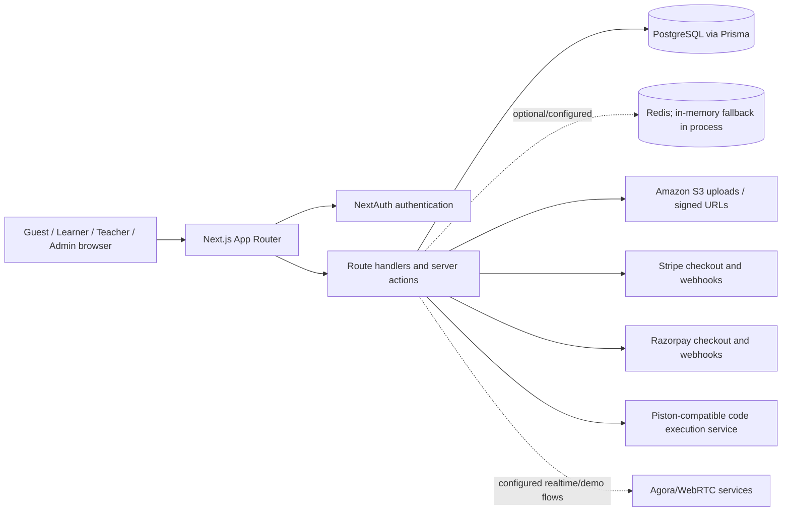
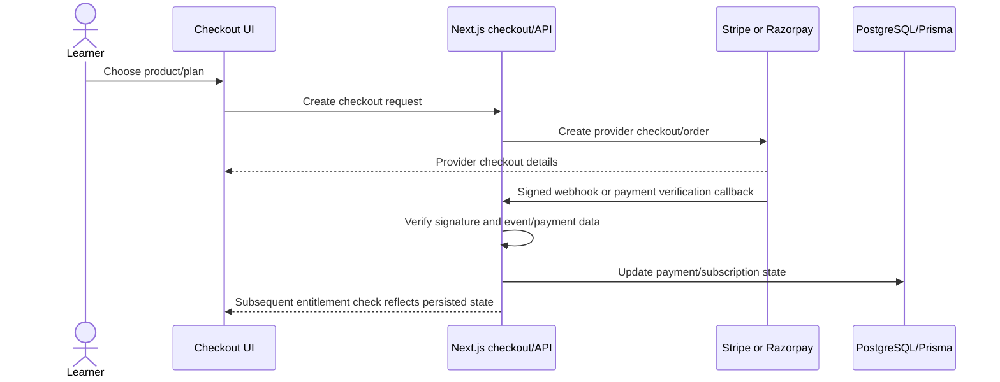

# TrillionSkill Software Requirements Specification

**Document status:** Code-derived baseline  
**Prepared:** 2026-10-05  
**Product/repository:** TrillionSkill (package name: `aspirantbook`)  
**Scope:** Current software structure and requirements evidenced by the repository. Proposed targets are clearly labelled; this is not a production certification.

## 1. Introduction

### 1.1 Purpose

This SRS captures the current software boundary, runtime architecture, external interfaces, data domains, security constraints, and quality requirements of the TrillionSkill web application. Read it with the [FRS](./FRS.md), which describes user-visible functional behavior.

### 1.2 Product scope

TrillionSkill is a mobile-first learning and exam-preparation platform. It includes public acquisition pages, authenticated learner areas, teacher/admin content tools, learning courses and tracks, assessments and competitive test series, commerce, PYQ/book features, and live/demo classroom flows.

The repository contains a Next.js App Router application, TypeScript/React UI, API route handlers and server actions, Prisma persistence, authentication, and integrations for payments, uploads, code execution, caching, and realtime media. Static inspection cannot establish deployment topology, operational SLAs, or whether every configured integration is active in production.

### 1.3 Definitions

| Term | Definition |
|---|---|
| CBT | Computer-based test/test-series attempt flow. |
| FRS | Functional Requirements Specification; user capabilities and business rules. |
| SRS | Software Requirements Specification; system behavior and quality/interface requirements. |
| RSC | React Server Component. |
| Entitlement | Server-side decision that a user may access a paid/restricted resource. |
| PYQ | Previous-year question paper/content. |

## 2. System context and users

### 2.1 System context



### 2.2 User classes

The application recognizes guests and signed-in users with `FREE`, `PREMIUM`, `TEACHER`, or `ADMIN` roles. Learner-facing routes are protected by middleware. Teacher/admin pages have role gates, while sensitive APIs/actions must independently enforce access to data they mutate. Refer to the FRS for role capabilities.

### 2.3 Operating environment

- Web application: Next.js 15.1.x, React 19, TypeScript 5, App Router.
- Styling/UI: Tailwind CSS, Radix primitives, lucide-react; responsive behavior and shell requirements are defined in `AGENTS.md` and `docs/responsive-ui-standards.md`.
- Persistence: PostgreSQL through Prisma 6; `DATABASE_URL` and `DIRECT_URL` are required.
- Authentication: NextAuth v5 beta, JWT/session callbacks and configured credentials/provider integrations.
- External services are environment-dependent: Stripe, Razorpay, S3, optional Redis, Piston-compatible execution endpoint, and Agora-related RTC features.

The dependency list and exact configuration are in [`package.json`](../package.json), [`.env.example`](../.env.example), [`next.config.js`](../next.config.js), and the auth/configuration modules.

## 3. Architecture and components

### 3.1 Application layers

1. **Presentation:** Route groups under `app/`, shared UI under `components/`, server-rendered pages by default and client components for interaction.
2. **Application logic:** `app/api/**/route.ts` route handlers and `lib/actions/**` server actions; domain helpers under `lib/`.
3. **Identity/access:** NextAuth session and role data; route-level middleware plus operation-level authorization.
4. **Persistence:** Prisma client and PostgreSQL schema in `prisma/schema.prisma`.
5. **Integrations:** Payment provider libraries, S3 clients/presigned uploads, Piston execution, Redis cache/leaderboard/rate limit helpers, and live media/token services.

### 3.2 Main software subsystems

| Subsystem | Main repository areas | Primary responsibilities |
|---|---|---|
| Identity/access | `auth.ts`, `auth.config.ts`, `middleware.ts`, `lib/auth/**` | Sign-in/session, role-aware route access, entitlement checks, sanitized return paths. |
| Learner portal | `app/(dashboard)/**`, `components/**` | Courses, learning, tracks, tests, assessments, PYQs, books, profile/settings and supporting tools. |
| Course/content management | `app/admin/**`, `lib/actions/admin/**`, `app/api/admin/**` | Curriculum, publishing, course metadata, user operations, exercises, tutorials and uploads. |
| Exam engine | `app/(exam)/**`, `app/api/exam/**`, `lib/exam/**` | Test setup, question access, attempt lifecycle, sync, submit, grading and result data. |
| Assessments | `app/(dashboard)/assessments/**`, `app/api/assessments/**` | Assessment start, attempts, submissions and results. |
| Commerce | `app/checkout/**`, `app/api/checkout/**`, `lib/payments/**`, `app/api/webhooks/**` | Checkout, payment/subscription state, coupons and provider webhook processing. |
| Live classroom/demo | `app/classroom/**`, `app/api/classroom/**`, `app/api/courses/demo/**`, `lib/agora/**`, `lib/webrtc/**` | Participation, teacher controls, chat/polls/notes/questions, tokens and demo interactions. |
| Auxiliary learning/catalogs | `app/(dashboard)/pyqs/**`, `books/**`, `tutorials/**`, `projects/**`, etc. | Learner and staff surfaces for adjacent product features. |

## 4. External interfaces

### 4.1 Browser and HTTP interface

The application serves HTML/RSC through App Router and JSON through route handlers. The current repository has roughly 100 learner/staff pages and roughly 95 route-handler files (repository inventory counts, not API contract guarantees). Route families include:

| Route family | Representative endpoints | Purpose |
|---|---|---|
| Authentication | `/api/auth/[...nextauth]`, `/api/auth/role`, `/api/auth/mobile-login` | Authentication/session and role information. |
| Courses | `/api/courses/enroll`, `/api/courses/progress`, `/api/courses/[slug]/demo-slots` | Enrollment, progress, course/demo data. |
| Exams | `/api/exam/series/*`, `/api/exam/attempt/*`, `/api/exam/[testId]/*` | Series/test discovery, attempt start/sync/submit/result, questions and leaderboard. |
| Assessments | `/api/assessments/[id]/start`, `/api/assessments/attempts/[attemptId]/submit` | Assessment attempt lifecycle. |
| Administration | `/api/admin/**` | Restricted content, catalog and operational actions. |
| Classroom | `/api/classroom/**`, `/api/courses/demo/**` | Classroom and demo controls, presence, interactions and tokens. |
| Checkout/payments | `/api/checkout/**`, `/api/verify-payment/razorpay`, `/api/webhooks/{stripe,razorpay}` | Checkout creation, verification and provider callbacks. |
| Upload/execution | `/api/upload/**`, `/api/execute` | File upload and code execution. |

There is no evidence of a single uniform response envelope: handlers return endpoint-specific JSON and HTTP status codes. API clients must use each endpoint's actual contract rather than assume the envelope proposed in older design material.

### 4.2 Authentication and authorization interface

- The browser uses NextAuth-managed sessions; callbacks place user ID, role, and subscription status on the session/token.
- Middleware redirects protected page requests to sign-in or role-appropriate areas.
- APIs/actions must validate session, resource ownership, role, and entitlement at the operation boundary.
- Public routes include acquisition/sign-in and selected public course/batch surfaces; actual route matching is defined in `middleware.ts`.
- Return paths are sanitized before redirect to avoid arbitrary external redirects.

### 4.3 Database interface and principal data domains

Prisma uses PostgreSQL. The schema has 47 model declarations and enums. Key domains:

| Domain | Principal models |
|---|---|
| Identity | `User`, `Account` |
| Curriculum | `Track`, `TrackCourse`, `Course`, `Chapter`, `Lesson`, `LessonVersion`, `Enrollment`, `Progress`, `Review` |
| Coding | `Exercise`, `TestCase`, `Submission` |
| Assessments | `Assessment`, `Question`, `AssessmentAttempt` |
| Exam series | `ExamSeries`, `ExamSeriesEnrollment`, `ExamTest`, `ExamSection`, `ExamQuestion`, `ExamAttempt`, `ExamAttemptAnswer` |
| Commerce | `Subscription`, `Payment`, `Coupon`, `CouponRedemption`, `PromoCode` |
| Engagement/analytics | `Achievement`, `UserAchievement`, `Notification`, `UserAnalytics`, `CourseAnalytics`, `RevenueAnalytics` |
| Content sales/operations | `ContentUpload`, `PyqCategory`, `PyqSubExam`, `PyqPaper`, `PyqLeadCapture`, `PyqUnlock`, and book/batch/demo/classroom-related models |

Refer to `prisma/schema.prisma` for authoritative fields, constraints, relations, indexes, and enum values. The database is the durable source of truth for domain records. Process-local fallback maps used by Redis helpers are ephemeral and must not be used as durable user state.

### 4.4 External service interfaces

| Service | Interface/configuration | Failure/configuration notes |
|---|---|---|
| Stripe | Stripe SDK; checkout/payment/subscription webhooks; `STRIPE_*` variables. | Webhook signature is checked; requires provider secrets, price IDs, endpoint registration, and live/test mode alignment. |
| Razorpay | Razorpay SDK; checkout/verification/webhook routes; `RAZORPAY_*` variables. | Signature verification and credentials required; test and live keys must match deployment. |
| S3 | AWS SDK put/get/delete and presigned URL helpers; `AWS_*` variables. | Supported types/sizes are defined in `lib/s3.ts`; bucket permissions and URL policy are deployment concerns. |
| Code execution | `lib/execution/piston.ts` calls configured `PISTON_API_URL` or default Piston endpoint. | Remote availability and runtime catalog are external. The current endpoint does not demonstrate per-case re-execution. |
| Redis | Optional ioredis client controlled by `REDIS_URL`. | Helpers fall back to process-local memory when unavailable; that fallback is not shared across instances and is not durable. |
| Live media | Agora token/client services and WebRTC support modules. | Requires provider credentials and real-device/network validation. |

## 5. Data and state requirements

1. Durable user, content, attempt, payment, and progress records shall be stored through PostgreSQL/Prisma.
2. Attempts shall be linked to their owning user and test. Sync and submit operations shall reject non-owner access and non-writable states.
3. Exam answer synchronization shall preserve sequence ordering so an older client write does not overwrite a newer persisted answer.
4. Payment state shall be changed only after provider callbacks/verification pass their signature/ownership checks.
5. Content imports must use external identifiers when matching imported entities, create drafts by default, and must not delete existing content as a side effect. See importer implementation and repository rules before executing import operations.
6. Runtime state such as temporary caches/leaderboard fallback values must not be treated as durable storage.

## 6. Security requirements

| ID | Requirement |
|---|---|
| SRS-SEC-01 | All protected data and mutations shall be authorized server-side using session identity, role, resource ownership, and relevant entitlements. |
| SRS-SEC-02 | All untrusted request bodies shall be validated for shape, type, size, and allowed values before use. Current coverage varies by route and requires continued audit. |
| SRS-SEC-03 | Payment webhooks shall verify provider signatures against the raw request body before applying state changes. |
| SRS-SEC-04 | Code execution shall remain delegated to a constrained external execution service; request-size/runtime limits shall be enforced. Do not claim a particular container isolation posture without verifying provider deployment. |
| SRS-SEC-05 | Imported/user-supplied HTML or SVG shall be sanitized; untrusted active content shall run only in an appropriately sandboxed frame without `allow-same-origin`, consistent with project rules. |
| SRS-SEC-06 | Secrets shall be supplied through environment/deployment secret management and never committed. `.env.example` shall contain placeholders only. |
| SRS-SEC-07 | Redirect destinations shall be constrained to safe local paths. |
| SRS-SEC-08 | File uploads shall enforce allowlisted MIME types and size limits and use access controls appropriate to whether media is public or private. |

Known repository-level points requiring validation: the Next.js configuration enables `dangerouslyAllowSVG` while also supplying a restrictive image CSP; validate this behavior before serving user-controlled SVG. Review each upload route's auth and ownership checks. Do not infer global audit-log immutability from the existence of audit routes/models.

## 7. Quality requirements and constraints

### 7.1 Responsive usability and accessibility

- Design mobile-first for a 360 px baseline and verify widths 320, 360, 390, 430, 768, 1024, and 1440 px.
- Below 1024 px, preserve the configured mobile shell behavior and its flag-off path.
- Prevent horizontal page overflow; allow long translated/Hindi text to wrap; target touch controls of at least 44×44 px.
- Respect safe-area insets and dynamic viewport sizing; fullscreen test/video flows must account for shell bars.
- Support keyboard focus, labels, reduced motion, dark mode, and 200% zoom.
- The detailed project UI standard is authoritative in `docs/responsive-ui-standards.md`.

### 7.2 Performance and capacity

- The project UI standard sets mobile experience budgets: LCP ≤ 2.5 s, INP ≤ 200 ms, CLS ≤ 0.1 on a mid-range phone/4G. Treat as product targets requiring measurement, not achieved metrics.
- No verified API latency, concurrency, uptime, or code-execution SLO was established by this scan. Numeric targets in older system-design docs are proposals unless supported by load-test/production evidence.
- Server Components are preferred; interactive client code and heavy editors/charts/players should be isolated or lazy-loaded where practical.

### 7.3 Reliability and recovery

- Exam time derives from persisted server timestamps; the client may sync answers using sequence values.
- Webhook handlers should tolerate retries and should be validated for idempotency and out-of-order delivery.
- Redis fallback to process memory is best-effort only; multi-instance consistency is not guaranteed by that fallback.
- Backups, restore objectives, multi-zone deployment, and disaster-recovery procedures are not evidenced in code and remain operational requirements to define.

### 7.4 Maintainability and verification

- TypeScript, Prisma, linting, and Next.js build tooling are configured. `package.json` does not define the `typecheck` script named in `AGENTS.md`; `npx tsc --noEmit` is the available typecheck command.
- Repository test inventory found very limited checked-in automated tests relative to product surface area. Add/maintain unit, API, e2e, accessibility, and responsive screenshot coverage for critical flows.
- `next.config.js` currently sets `typescript.ignoreBuildErrors` and `eslint.ignoreDuringBuilds`; a successful build alone therefore does not prove type or lint cleanliness.
- Requirements should be traced to routes/actions/schema and verified in a configured environment with representative learner, teacher, and admin accounts.

## 8. Configuration requirements

| Variable family | Purpose | Required when |
|---|---|---|
| `AUTH_SECRET`, database URLs | Session and PostgreSQL connectivity | Core application operation. |
| `STRIPE_*` | Stripe checkout and webhooks | Stripe commerce enabled. |
| `RAZORPAY_*` | Razorpay checkout and verification | Razorpay commerce enabled. |
| `AWS_*` | S3 storage and signed uploads | S3 file features enabled. |
| `REDIS_URL` | Shared cache/leaderboard/rate-limit operations | Shared Redis behavior required; otherwise helpers may use local fallback. |
| `PISTON_API_URL` | Remote code execution endpoint | Code execution enabled. |
| Agora/RTC variables | Realtime demo/classroom tokens/media | Corresponding live features enabled. |
| `NEXT_PUBLIC_APP_URL` and public keys | Browser URL and provider client config | Deployment-specific integration setup. |

See `.env.example` for current names. Never copy placeholder values into a production deployment.

## 9. Key sequence flows

### 9.1 Exam attempt

```mermaid
sequenceDiagram
  actor Learner
  participant UI as Exam UI
  participant API as Next.js exam API
  participant DB as PostgreSQL/Prisma
  Learner->>UI: Select test and language
  UI->>API: POST /api/exam/attempt/start
  API->>API: Authenticate, validate test and entitlement
  API->>DB: Resume active attempt or create attempt
  DB-->>API: Attempt, server start/deadline, saved answers
  API-->>UI: Attempt state
  UI->>API: POST /api/exam/attempt/{id}/sync (answers + sequence)
  API->>DB: Verify owner/status; upsert answers; reject stale sequence
  UI->>API: Submit attempt
  API->>DB: Grade/finalize and persist result
  API-->>UI: Submission/result state
```

Offline IndexedDB durability is not asserted by this sequence; confirm the client implementation separately.

### 9.2 Paid checkout



## 10. Constraints, assumptions, and open questions

### Constraints

- Existing stack and protected mobile shell must remain compatible.
- PostgreSQL and Prisma define the persisted data model.
- User records, lessons, courses, and learning progress must not be deleted to satisfy new feature behavior; archive where appropriate.
- No runtime data may be written to local disk as persistent state.

### Assumptions

- This specification describes the checked-in repository as of 2026-10-05, not a live deployment.
- External integrations are optional/configuration-dependent unless deployment configuration demonstrates they are active.
- “Implemented in code” does not mean validated with real provider accounts or production data.

### Open questions for product/operations

1. Which learner areas are launch-critical and which current route surfaces are placeholders or retired?
2. What are the intended and measurable availability, latency, concurrency, recovery-point, and recovery-time targets?
3. Is offline test taking required? If so, what local storage, conflict, expiry, and recovery guarantees are expected?
4. What code execution languages, test-case behavior, sandbox limits, and hidden-test requirements are contractual?
5. What are the definitive teacher/admin permission matrix and approval/publishing workflow?
6. Which supported payment plans, refund/cancellation rules, tax/currency behavior, and webhook reconciliation guarantees are required?
7. Which media, privacy, retention, audit, and data deletion policies apply to classroom, uploads, doubts, and learner analytics?

## 11. Related references

- [FRS.md](./FRS.md) — user-visible functions and business rules.
- [AGENTS.md](../AGENTS.md) — project-wide engineering and product constraints.
- [Responsive UI standards](./responsive-ui-standards.md) — detailed responsive/accessibility standard.
- `prisma/schema.prisma` — authoritative persisted data model.
- `middleware.ts`, `auth.ts`, `auth.config.ts` — authentication and page access behavior.
- `docs/COMPREHENSIVE_SYSTEM_DESIGN.md` and `docs/MASTER_SYSTEM_DESIGN.md` — older design/aspirational references; verify claims against current code before treating them as implemented requirements.

