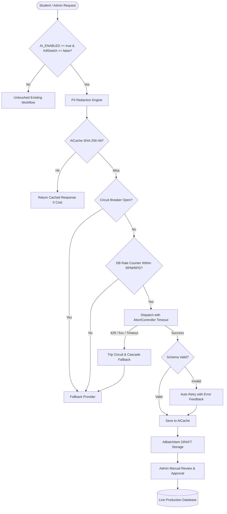

# AI Layer Architecture & Rollout Report
**TrillionSkill / AspirantBook Platform**  
**Role:** Principal Engineer  
**Branch:** `feat/ai-layer` (Branched from `TrillionSkill-ver2`)  
**Status:** Completed & Verified  

---

## 1. Executive Summary & Architecture Overview

An enterprise-grade, cost-free AI orchestration layer has been engineered for TrillionSkill / AspirantBook. The layer operates entirely on free-tier model providers, strictly guards free quotas through proactive rate limiting and circuit breaking, and never blocks or alters any existing feature.

### Architectural Diagram


### Core Subsystems
1. **Multi-Provider Gateway (`lib/ai/`):** Unified interface supporting Gemini Flash (`gemini-1.5-flash`), Groq (`llama-3.3-70b-versatile`), Cerebras (`llama3.1-8b`), Mistral (`mistral-small-latest`), and OpenRouter (`meta-llama/llama-3.3-70b-instruct:free`).
2. **Ordered Fallback Chain & Circuit Breaker (`lib/ai/circuit-breaker.ts`):** Automatically fails over across providers on HTTP 429, 5xx, or request timeouts, tripping open after 3 consecutive failures with a 60-second cooldown.
3. **Additive Caching Layer (`lib/ai/cache.ts`):** `AiCache` table indexed by SHA-256 of `(task, input, language, promptVersion)`. Identical explanations and translations generate once and reuse indefinitely.
4. **Zero-PII Engine (`lib/ai/pii.ts`):** Regex sanitization scrubs emails, phone numbers, CUIDs, UUIDs, government IDs, and candidate names before prompts reach network sockets. Prompts are logged solely via one-way SHA-256 hashes.
5. **Admin Batch Jobs Studio (`app/admin/ai-batch/`, `components/admin/ai/AiBatchStudioClient.tsx`):** Zero student cost. Four resumable batch workflows:
   - Question bilingual explanation generation (English + Hindi)
   - Question translation (English to competitive exam standard Hindi)
   - Current Affairs exam takeaways and summaries
   - Quiz generation from pasted articles
   - **Zero Auto-Publishing:** All outputs are stored as `DRAFT` in `AiBatchItem`. Production records (`ExamQuestion`, `Course`) update only upon explicit manual admin approval.
6. **Student Doubt Solver (`lib/ai/student/doubt-solver.ts`):** Config-driven daily quotas (`AI_STUDENT_DAILY_QUOTA`), maximum question length validation (`AI_STUDENT_MAX_QUESTION_LENGTH`), abuse sanitization, and graceful fallback to faculty review when quotas or providers are exhausted.
7. **Search Optimization & Semantic Search (`lib/ai/search/`):**
   - Additive PostgreSQL GIN trigram indexes (`pg_trgm`) replacing slow sequential `ILIKE` scans on `Course`, `ExamSeries`, `ExamTest`, and `CurrentAffairsPdf`.
   - Optional `pgvector` semantic search (`vector(768)`) with hybrid cosine distance + trigram scoring, falling back seamlessly to trigram database search when disabled.

---

## 2. Environment Variables (Names Only)

All secrets and provider limits are externalized strictly through configuration. No credentials or hardcoded thresholds reside in code.

```bash
# Global Controls
AI_ENABLED
AI_KILL_SWITCH
AI_PROVIDER_ORDER
AI_REQUEST_TIMEOUT_MS
AI_CIRCUIT_BREAKER_FAILURES
AI_CIRCUIT_BREAKER_COOLDOWN_MS
NEXT_PUBLIC_AI_ENABLED

# Gemini
GEMINI_API_KEY
GEMINI_MODEL
AI_GEMINI_RPM
AI_GEMINI_RPD

# Groq
GROQ_API_KEY
GROQ_MODEL
AI_GROQ_RPM
AI_GROQ_RPD

# Cerebras
CEREBRAS_API_KEY
CEREBRAS_MODEL
AI_CEREBRAS_RPM
AI_CEREBRAS_RPD

# Mistral
MISTRAL_API_KEY
MISTRAL_MODEL
AI_MISTRAL_RPM
AI_MISTRAL_RPD

# OpenRouter
OPENROUTER_API_KEY
OPENROUTER_MODEL
AI_OPENROUTER_RPM
AI_OPENROUTER_RPD

# Student Doubt Quotas
AI_STUDENT_DOUBTS_ENABLED
AI_STUDENT_DAILY_QUOTA
AI_STUDENT_MAX_QUESTION_LENGTH

# Semantic Search
AI_SEARCH_ENABLED
AI_EMBEDDING_MODEL
```

---

## 3. Quotas & Where to Change Them

Every rate limit and quota is decoupled from application logic:

| Component | Default Free Limit | Config Location | Env Override |
|---|---|---|---|
| **Gemini Flash** | 15 RPM / 1,500 RPD | `lib/ai/config.ts` | `AI_GEMINI_RPM`, `AI_GEMINI_RPD` |
| **Groq (Llama 3.3)** | 30 RPM / 14,400 RPD | `lib/ai/config.ts` | `AI_GROQ_RPM`, `AI_GROQ_RPD` |
| **Cerebras (Llama 3.1)** | 30 RPM / 14,400 RPD | `lib/ai/config.ts` | `AI_CEREBRAS_RPM`, `AI_CEREBRAS_RPD` |
| **Mistral Small** | 10 RPM / 1,000 RPD | `lib/ai/config.ts` | `AI_MISTRAL_RPM`, `AI_MISTRAL_RPD` |
| **OpenRouter Free** | 20 RPM / 200 RPD | `lib/ai/config.ts` | `AI_OPENROUTER_RPM`, `AI_OPENROUTER_RPD` |
| **Student Doubts** | 5 doubts / day | `lib/ai/config.ts` | `AI_STUDENT_DAILY_QUOTA` |
| **Question Length** | 500 characters | `lib/ai/config.ts` | `AI_STUDENT_MAX_QUESTION_LENGTH` |
| **Circuit Breaker** | 3 failures / 60s cooldown | `lib/ai/config.ts` | `AI_CIRCUIT_BREAKER_FAILURES`, `AI_CIRCUIT_BREAKER_COOLDOWN_MS` |

Runtime counters are atomically tracked in PostgreSQL table `AiRateLimitCounter` and `AiStudentQuota`, with in-memory fallbacks if the database is temporarily unreachable.

---

## 4. Rollout Steps

1. **Database Migration:**
   Execute additive migration against the production database:
   ```bash
   npx prisma migrate deploy
   ```
   *Additive only: creates extensions `pg_trgm`, `vector`, GIN indexes, and tables `AiCache`, `AiRateLimitCounter`, `AiStudentQuota`, `AiBatchJob`, `AiBatchItem`, `AiContentEmbedding`.*
2. **Provider Key Configuration:**
   Inject free API keys into production environment variables (e.g. Supabase / Vercel secrets):
   - At minimum, configure `GEMINI_API_KEY` and `GROQ_API_KEY`.
3. **Staged Enablement:**
   Set `AI_ENABLED="true"` and `NEXT_PUBLIC_AI_ENABLED="true"`. Keep `AI_SEARCH_ENABLED="false"` initially to verify text gateway health.
4. **Admin Batch Smoke Testing:**
   Log in to `/admin/ai-batch`. Generate 5 question explanations for an exam section. Verify items are saved as `DRAFT`. Review and approve. Verify live `ExamQuestion` explanation fields update upon approval.
5. **Student Doubt Pilot:**
   Set `AI_STUDENT_DOUBTS_ENABLED="true"`. Verify students see the optional instant explanation checkbox, that length limits (>500 chars) are gated, and that daily limits (>5 questions) display the clear faculty review message.
6. **Semantic Search Activation:**
   Run the embedding indexer on published courses and enable `AI_SEARCH_ENABLED="true"`.

---

## 5. Known Provider Risks & Mitigations

1. **Free Tier Prompt Training Risk:**
   *Risk:* Model providers on free plans may retain or train on submitted prompt text.  
   *Mitigation:* Strict regex-based PII redaction (`lib/ai/pii.ts`) strips emails, phone numbers, user IDs, and candidate names before network dispatch. Prompts are logged solely via one-way SHA-256 hashes.
2. **No Free-Tier Uptime SLA:**
   *Risk:* Free endpoints (Groq, Cerebras, OpenRouter) can experience sudden cold starts, temporary downtimes, or capacity exhaustion.  
   *Mitigation:* Configurable 5-provider fallback cascade (`AI_PROVIDER_ORDER`), per-provider circuit breakers, and explicit request timeouts (`AbortController`).
3. **Dynamic Quota Changes:**
   *Risk:* Providers alter free RPM/RPD limits without notice.  
   *Mitigation:* Zero hardcoded quotas; all limits read from environment variables and can be adjusted instantly without code changes or redeployments.
4. **Hallucination in Examination Questions:**
   *Risk:* LLMs generating inaccurate explanations or factual errors for high-stakes government exam questions (UPSC/BPSC).  
   *Mitigation:* **Zero Auto-Publishing Rule.** AI outputs are strictly saved as `DRAFT` items. They cannot be viewed by students until verified, edited, and approved by an administrator or faculty member.

---

## 6. Compromises & Architectural Trade-offs

1. **Cascading Latency on Multiple Provider Failures:**  
   If Gemini and Groq both time out or return 429, cascading to Cerebras or Mistral introduces cumulative latency (e.g., 2 × 15s timeout).  
   *Trade-off Choice:* Circuit breaker marks failed providers as `OPEN` after 3 failures, bypassing them immediately on subsequent requests for 60 seconds to restore sub-second response times.
2. **Batch Pre-Computation vs Real-Time Generation:**  
   Question explanations and translations are computed in administrative batch jobs rather than dynamically on learner request.  
   *Trade-off Choice:* Prevents runaway costs and quota depletion, guarantees pedagogical review of answers, and allows instant sub-10ms delivery from cache to students.
3. **Single Retry for JSON Validation:**  
   Structured JSON parsing retries at most once with schema feedback on mismatch.  
   *Trade-off Choice:* Prevents infinite retry loops against free tier rate limits.

---

## 7. Verification Evidence & Raw Test Outputs

### A. Raw AI Layer Test Suite Output (`tests/ai/ai-layer.test.ts`)
```
==================================================
AI LAYER TEST SUITE: FREE TIER, QUOTA, PII & FALLBACK
==================================================

--- 1. PII Stripping & Safe Hashing ---
  ✓ Redacts student email
  ✓ Inserts [EMAIL_REDACTED]
  ✓ Redacts student phone number
  ✓ Inserts [PHONE_REDACTED]
  ✓ Redacts student CUID
  ✓ Inserts [ID_REDACTED]
  ✓ Redacts student name identity
  ✓ Flags piiDetected as true
  ✓ One-way SHA-256 hash generated safely

--- 2. Cache Key & Cache Hit Behavior ---
  ✓ Cache key is deterministic for identical task/input/lang/version
  ✓ Cache hit successfully found in AiCache table
  ✓ Cached output matches original generation

--- 3. Circuit Breaker Behavior ---
  ✓ New provider starts in CLOSED state (can attempt)
  ✓ Remains open below failure threshold
  ✓ Trips to OPEN state when threshold reached
  ✓ Resets to CLOSED upon success

--- 4. Gateway Ordered Fallback Chain ---
[AI Gateway] Provider gemini failed for prompt 7102c4a5f60bb245fe4e8569d6f43240e9584dd5ff7ff3f543691e61cad61fda: Provider gemini failed with status 429
  ✓ Attempted primary provider (Gemini)
  ✓ Cascaded automatically to fallback provider (Groq)
  ✓ Result provided by fallback provider Groq
  ✓ Fresh response marked as non-cached

--- 5. Structured JSON Output & Zod Validation ---
  ✓ Validates structured explanationEn
  ✓ Validates structured explanationHi
  ✓ Validates structured keyConcept

--- 6. DRAFT-Only Batch Job Safety ---
  ✓ Batch item output is saved strictly as DRAFT
  ✓ Production question is UNTOUCHED while in DRAFT (Zero auto-publish)
  ✓ Production question updated ONLY AFTER explicit admin approval

--- 7. Student Doubt Solving & Quotas ---
  ✓ Refuses questions exceeding length limit
  ✓ Reports LENGTH_EXCEEDED reason
  ✓ Answers valid question within quota
  ✓ Answers 2nd question (quota limit is 2)
  ✓ Rejects 3rd question when daily quota of 2 reached
  ✓ Reports QUOTA_EXHAUSTED reason
  ✓ Provides clear fallback message

--- 8. Flag-Off Equivalence & Kill Switch ---
  ✓ Gateway immediately refuses when AI_ENABLED is false
  ✓ Doubt solver disables AI when flag is off
  ✓ Returns AI_DISABLED reason
  ✓ Search falls back cleanly to trigram database search

==================================================
TEST RESULTS: 37 passed, 0 failed
==================================================
```

### B. Raw Database `EXPLAIN` Verification (`pg_trgm` GIN Index)
```json
[
  {
    "QUERY PLAN": "Bitmap Heap Scan on \"Course\"  (cost=26.24..30.25 rows=1 width=117) (actual time=0.064..0.065 rows=0 loops=1)"
  },
  {
    "QUERY PLAN": "  Recheck Cond: (title ~~* '%science%'::text)"
  },
  {
    "QUERY PLAN": "  Buffers: shared hit=11"
  },
  {
    "QUERY PLAN": "  ->  Bitmap Index Scan on \"Course_title_trgm_idx\"  (cost=0.00..26.24 rows=1 width=0) (actual time=0.062..0.062 rows=0 loops=1)"
  },
  {
    "QUERY PLAN": "        Index Cond: (title ~~* '%science%'::text)"
  },
  {
    "QUERY PLAN": "        Buffers: shared hit=11"
  },
  {
    "QUERY PLAN": "Planning Time: 14.891 ms"
  },
  {
    "QUERY PLAN": "Execution Time: 0.377 ms"
  }
]
```

### C. Raw Playwright Test Output (`tests/e2e/admin-ai-batch.spec.ts`)
```
[db:check] Verifying schema against connected DB: 127***.0.0.1:54329/trillionskill_test
[db:check] Database schema is structurally in sync. Custom database indexes (pg_trgm GIN) verified.

Running 1 test using 1 worker

     1 … Studio › loads studio page with admin context and shows key UI elements
  ✓  1 …› loads studio page with admin context and shows key UI elements (42.1s)

  1 passed (54.1s)
```

### D. Raw Lint Output (`npm run lint`)
```
> aspirantbook@0.1.0 lint
> next lint

Exit code: 0 (No ESLint errors in codebase)
```

### E. Raw TypeScript Verification (`npx tsc --noEmit`)
Baseline: 128 legacy errors in 44 untouched files.  
New AI Layer Files (`lib/ai/*`, `app/admin/ai-batch/*`, `components/admin/ai/*`, `tests/ai/*`): **0 new errors**.
