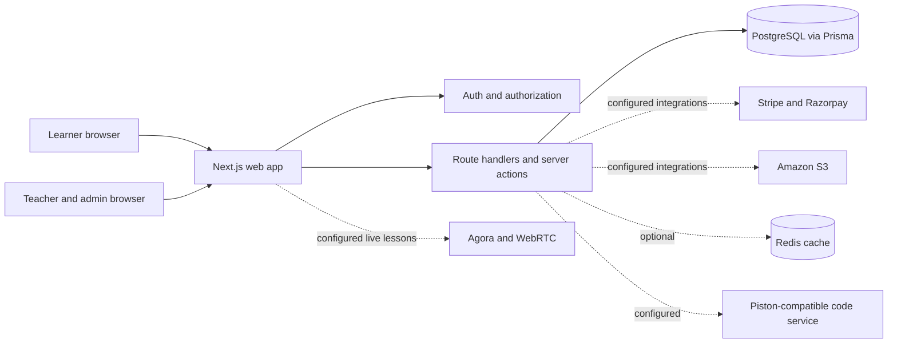

# High Level Design for TrillionSkill

**Status:** Current-state architecture baseline plus proposed pilot controls  
**Audience:** Product, engineering, operations, security, and reviewers

## Purpose and design position
This HLD describes the deployed-software boundary evidenced by the repository and distinguishes it from desired production topology. TrillionSkill is a Next.js App Router learning and exam-preparation application with server-rendered routes, API handlers and server actions, Prisma/PostgreSQL persistence, role-aware access, and optional external providers. The repository does not establish a verified production deployment, multi-region design, service-level objective, or CI/CD pipeline; those remain decisions to approve and verify.

## System context

The diagram shows logical responsibilities, not a confirmed hosting topology. Provider connections are environment-dependent. The app must treat the database as durable application state; Redis/process-memory fallbacks are not authoritative stores.

## Main components
| Component | Responsibility | Evidence / boundary |
|---|---|---|
| Browser UI | Responsive learner, teacher, and administrator journeys | Next.js pages and shared components; mobile shell controlled by `NEXT_PUBLIC_ENABLE_MOBILE_NATIVE_SHELL` |
| Next.js application | Rendering, business logic, server actions, API route handlers | `app/`, `lib/`, `auth.ts`, `middleware.ts` |
| Identity and access | Session identity, roles, ownership and entitlements | NextAuth v5 beta and server-side checks; middleware alone is not sufficient |
| Relational data | Users, courses, lessons, attempts, payments and related records | Prisma schema and migration history; PostgreSQL deployment details must be supplied |
| External providers | Payment, storage, code execution, cache, and live media | Optional/configured integrations; credentials and operational readiness are unverified |

## Trust boundaries and critical flows
1. Every protected read or mutation derives user identity on the server and validates role, ownership, and entitlement.
2. Test-attempt timing and ownership are server authoritative. Clients synchronize answers with sequence/order checks; local persistence behavior requires client verification.
3. Payment access follows verified provider callbacks or server-side verification; browser redirects alone cannot grant paid access.
4. Imported or uploaded content is untrusted. Validate file type/size, permissions, external IDs, and rendering/sandbox rules.
5. Code execution is delegated to a constrained external execution service; do not infer isolation guarantees from the app repository.

## Proposed pilot deployment shape
Use separately configured local, development, test/UAT, and production environments, each with an independently managed database and provider credentials. Use immutable build artifacts, secrets managed outside Git, explicit migration approval, backup/restore evidence, and staged production rollout. This is a target design pending platform-owner approval, not a claim about existing infrastructure.

## Architecture decisions to record
Choose hosting/provider ownership, database topology and backup targets, Redis necessity, runtime code-isolation assurance, media retention, monitoring and alert destinations, and approved availability/recovery targets. Record each accepted choice in `docs/DECISIONS.md` with owner and date.

## Related documents
Continue to the LLD for module contracts, the TDD for implementation decisions, and the SRS/FRS for constraints and current behavior. See the master documentation index.
