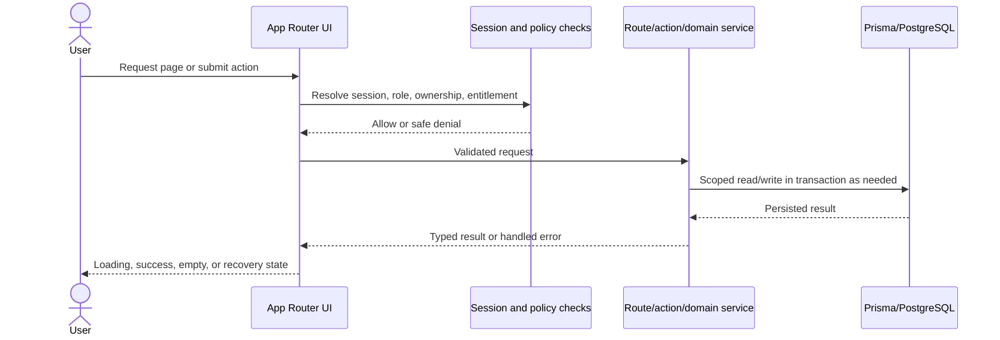

# Low Level Design for TrillionSkill

**Status:** Repository-derived module map; verify against current branch before implementation  
**Audience:** Engineers and reviewers

## Purpose
This LLD translates the HLD into module boundaries, data ownership, and request patterns. Paths are representative and should be checked against the active code before a change; this is not a generated API contract.

## Layered request model

## Module boundaries
| Domain | Primary code areas | Owns |
|---|---|---|
| Identity/access | `auth.ts`, `auth.config.ts`, `middleware.ts`, `lib/auth/` | Session roles and access decisions |
| Learning | `app/(dashboard)/courses/`, course actions and Prisma models | Enrollment, lesson access, progress |
| Exams | `app/(exam)/`, `app/api/exam/`, `lib/exam/` | Test discovery, attempts, answer sync and results |
| Assessments/exercises | dashboard assessment routes, assessment APIs, `lib/execution/` | Assessment attempts and execution handoff |
| Commerce | checkout APIs, webhook APIs, `lib/payments/`, entitlements | Orders, provider events, subscriptions and access grants |
| Content operations | `app/admin/`, `lib/actions/admin/`, admin APIs | Staff content lifecycle and operations |
| Integrations | provider-specific libraries and environment configuration | External service boundary and failure mapping |

## Data and transaction rules
- Use Prisma schema/migrations as the durable data contract. Never change established internal IDs to simplify migration.
- Scope learner-owned records by authenticated user ID on every request; do not trust IDs supplied by the browser.
- Make start/submit/payment webhook operations idempotent where retries are expected. Keep state transitions explicit and auditable.
- Perform related writes in a transaction when partial completion would produce invalid state.
- Archive content when preserving learner history matters. Never cascade-delete progress or payment evidence without approved retention policy.

## Error and state contracts
Each user flow defines success, validation failure, permission denial, not-found, provider/database failure, and retry/recovery behavior. Responses must not expose secrets or private resource existence. API response shapes are endpoint-specific until a shared contract is formally introduced.

## Mobile UI boundary
Use one data source and responsive rendering. Preserve feature parity and the mobile-shell flag-off path. Test attempts use server timing, answer autosave, refresh resume, and the mobile question-palette pattern from the project standard. UI styling work must read `docs/responsive-ui-standards.md`.

## Change checklist
Update the owning module, relevant FRD/RTM mappings, tests, API reference, and release note. Include migration/backfill and rollback implications when persisted state changes.
