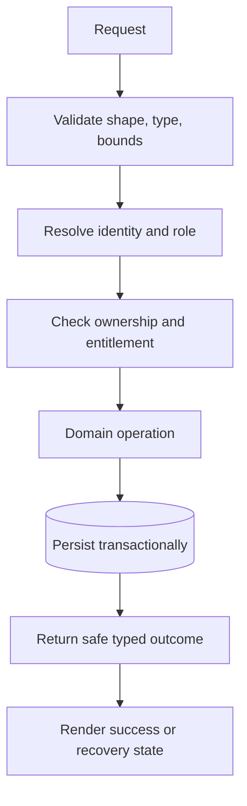

# Technical Design Decisions for TrillionSkill

**Status:** Proposed design baseline for review; decisions not approved are labeled open  
**Audience:** Engineering leads, implementers, security, operations

## Purpose
This TDD records implementation choices for a focused TrillionSkill release. It is intentionally explicit about observed stack choices versus proposals; it does not assert an approved SLA, delivery pipeline, or cloud account setup.

## Current technical baseline
Next.js 15 App Router, React 19, TypeScript 5, Tailwind CSS, Radix primitives, NextAuth v5 beta, Prisma 6, and PostgreSQL are evidenced by repository configuration. Stripe, Razorpay, S3, Redis, Piston-compatible execution, and Agora-related code exist as integration surfaces whose enabled state depends on configuration and external validation.

## Key decisions
| Decision | Current position | Required evidence / open point |
|---|---|---|
| Application shape | Modular Next.js application; server components by default | Review route/domain boundaries as product grows |
| Persistence | PostgreSQL through Prisma migrations | Verify baseline, migration chain, backup/restore, and target DB owner |
| Authentication | NextAuth session with server-side authorization | Audit every API/action and prove role/ownership boundaries |
| Exams | Persisted attempt state and server-derived deadline | Exercise stale sync, duplicate submit, expiry, and refresh cases |
| Payments | Stripe and Razorpay integration points | Live/test configuration, signature checks, reconciliation and refund SOP |
| Code execution | External execution endpoint | Confirm isolation, resource caps, supported languages, and vendor SLA |
| UI | Mobile-first responsive shell, same data and feature set | Follow project UI standard and include light/dark visual QA |
| Release | Staged environments with migration and rollback gates | CI/CD provider and deployment ownership remain TBD |

## Request and persistence pattern

At each decision, deny safely and record operationally useful context without leaking secrets or unnecessary personal data.

## Security and privacy
Validate all server action and API inputs; apply server-side ADMIN/TEACHER/STUDENT policy; treat uploaded/imported HTML and SVG as untrusted; use sandboxed frames without `allow-same-origin` where applicable; store secrets in environment/deployment secret systems; minimize learner data in logs. Define retention, minors/guardian, recording, and deletion policy with qualified owners before launch.

## Quality and performance
Targets in the project UI standard are acceptance targets, not measured achievements: mobile LCP <= 2.5s, INP <= 200ms, CLS <= 0.1 on a mid-range phone/4G. Measure representative logged-in learner journeys. Add automated unit, API, E2E, accessibility, and responsive checks around critical flows.

## Open decisions
Hosting, environment mapping, CI provider, database service, secret owner, observability vendor, code-execution isolation, backup RPO/RTO, availability target, rollout/rollback method, and data retention. Assign owners before a production commitment.
