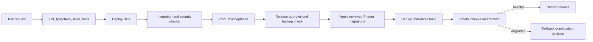

# TrillionSkill Deployment and Release Runbook

**Status:** Proposed operating procedure; fill platform-specific commands and owners before production use  
**Audience:** Release manager and on-call engineer

## Environment map
| Environment | Purpose | Data/credentials | Current verified endpoint/owner |
|---|---|---|---|
| Local | Developer iteration | Synthetic/local data; test keys | TBD |
| DEV | Shared integration | Non-production dataset and keys | TBD |
| TEST/UAT | Acceptance and release rehearsal | Synthetic/approved masked data | TBD |
| PROD | Live learner service | Production data and live credentials | TBD |

This repository does not identify hosted endpoints or prove this environment topology. The service owner must complete the map before deployment.

## Release flow

This is a target process. The CI/CD provider and current automation are TBD; do not interpret the chart as existing automation.

## Pre-release gate
1. Confirm scope, commit/tag, change approvals, and no unresolved release-blocking defect.
2. Confirm test plan, traceability, student/teacher/admin account evidence, security checks, mobile screenshots, and UAT sign-off.
3. Review migration SQL and expected duration; take and identify a recoverable backup. Confirm restore owner.
4. Verify environment, domain, secrets, payment mode, webhook URLs, storage policy, feature flags, and alert routing. Never print secrets.
5. Agree on smoke cases, monitoring window, rollback trigger, and decision owner.

## Deploy and verify
Use the platform’s approved deployment mechanism. Apply Prisma migrations with `npx prisma migrate deploy` only after approval and backup checks; never use `db push` on production. Deploy the immutable artifact, verify health/auth/catalog/attempt/payment test-mode or approved smoke paths, inspect logs/metrics, and record build, migration, result, and approver.

## Rollback
Stop further rollout, preserve logs and event IDs, assess whether schema changes are backward-compatible, and prefer application rollback plus forward fix. Do not reverse a migration or delete user data without a reviewed recovery plan and explicit owner approval. Escalate payment/data integrity or privacy incidents immediately.

## Required blanks before go-live
Platform-specific commands, access roles, endpoint inventory, database backup/restore steps, migration lock strategy, release window, rollback compatibility, smoke account ownership, monitoring dashboard, paging route, and communications contacts.
