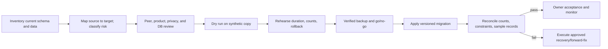

# TrillionSkill Data Migration Strategy

**Status:** Guardrails and execution template; no specific production migration is authorized  
**Audience:** Engineering, database owner, product/data owner, release approver

## Principles
Protect learner identity, content, attempts, payments, and progress. Preserve internal IDs and relationships. Use Prisma migrations; avoid production `db push`. Treat destructive transformations as high risk and require explicit approval, backup, tested recovery, and stakeholder notice.

## Migration lifecycle

## Required migration plan
Document source/target versions, record counts, mapping and defaults, null/duplicate handling, ID preservation, content rights, privacy classification, dependency order, expected locks/downtime, batching, runtime estimate, integrity queries, application compatibility, rollback/forward-fix, backup ID, owners, and approvals.

## Execution controls
1. Create a migration with Prisma and inspect generated SQL; add reviewed SQL for constraints Prisma cannot represent.
2. Test from a clean baseline and an anonymized/synthetic snapshot; test both existing and new data paths.
3. Confirm backup restore on an isolated target before a high-risk migration.
4. Schedule an approved window, pause conflicting writes if required, record migration logs and exact build/schema version.
5. Validate row counts, foreign keys, uniqueness, payment totals, attempt ownership, progress continuity, and sampled learner journeys.
6. Monitor for regression and retain the reconciliation report.

## Rollback policy
Prefer backward-compatible expand/migrate/contract changes. If reversal could lose user data or break newer writes, stop and use the approved forward recovery plan. No destructive rollback, ID rewrite, or production migration proceeds without explicit authorization and backup reminder.
